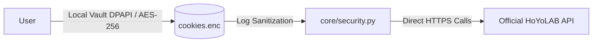
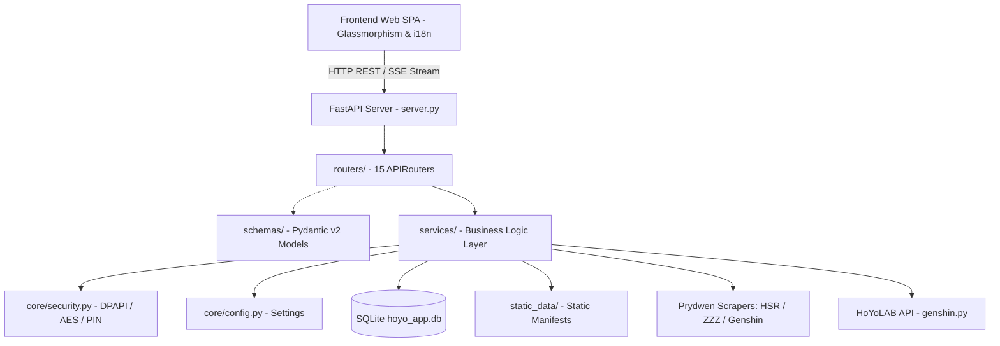

# 🤖 Cabeça de Droid (HoYo Metagame Suite v5.3+)

<p align="center">
  <b>Language / Idioma:</b> <a href="README.md">🇧🇷 Português</a> | <a href="README.en.md">🇺🇸 English</a>
</p>

[](https://www.python.org/)
[](https://fastapi.tiangolo.com/)
[](LICENSE)
[](tests/)
[](SECURITY.md)

Local intelligent suite featuring a **Glassmorphism Web UI** (HTML5/CSS3/ES6+ Modular) and a modular Python backend (**FastAPI + Clean Architecture + SQLite + Playwright + Windows DPAPI Security Vault + Zero-Maintenance Datamines**).

> [!NOTE]
> **About the name:** "Cabeça de Droid" (Droid Head) is a reference to *Honkai: Star Rail* — the affectionate nickname Herta gives to the **Aeon Nous** (the Aeon of Erudition), an astral supercomputer that ascended to godhood.

---

## ⚡ Quick Start (3 Steps)

```bash
# 1. Clone and enter the repository
git clone https://github.com/Lacas0010/Cabeca_de_Droid.git
cd Cabeca_de_Droid

# 2. Create virtual environment and install dependencies
python -m venv .venv
.\.venv\Scripts\Activate.ps1   # Linux/macOS: source .venv/bin/activate
pip install -r requirements.txt
playwright install chromium

# 3. Launch the application
python main.py
```

* **Local PC Access:** `http://127.0.0.1:8000`
* **Mobile / Tablet Access (Local Wi-Fi):** `http://<YOUR_PC_IP>:8000` *(configurable in Settings)*
* **Run Tests:** `python -m unittest discover tests` *(159 unit tests included)*

---

## 🌟 Key Features

| Module | Icon | Description |
| :--- | :---: | :--- |
| **1. System Tray Icon** | 🛸 | Minimized background execution on Windows 10/11 with a context menu (open dashboard, sync roster, toggle notifications, and shutdown server). |
| **2. Endgame Team Matcher** | ⚔️ | Matches meta team compositions (MoC, Pure Fiction, Apocalyptic Shadow, Abyss, Shiyu Defense) against your real SQLite roster, calculates compatibility %, and recommends functional substitutes from your owned characters. |
| **3. Official Pity & Warp Tracker** | 📜 | Import/export real warp logs in universal UIGF v2.4/SRGF standard, exact current pity calculation, 100% guarantee vs 50/50 state, and luck analytics. |
| **4. Relic Swap Sandbox** | 🧪 | Simulate relic/artifact swap ("What if I equip this piece?") predicting score shifts, Roll Value deltas, stat differences, and new speed breakpoints. |
| **5. Multi-UID Switcher** | 👥 | Instant zero-reload switching between multiple saved accounts for the same game in SQLite, with isolated roster and gear cache. |
| **6. Real-Time Energy Monitor** | 🔋 | Resin, Trailblaze Power, and Battery charge monitor with animated SVG circular gauges and countdown to cap. |
| **7. 6h Auto Check-in** | 🎁 | Autonomous background redemption of HoYoLAB daily check-in rewards every 6 hours stored in SQLite. |
| **8. Daily 04:00 Auto-Sync** | ⏰ | Scheduled daily sync updating character rosters, stats, and builds with diff detection. |
| **9. Glassmorphism UI & ES6** | 📁 | Modern dark theme, per-game accent colors, off-canvas mobile drawer, full internationalization (PT-BR / EN-US), and clean modular ES6 architecture. |
| **10. LAN / Wi-Fi Access** | 📱 | On-demand binding to `0.0.0.0:8000` for seamless dashboard use on smartphones and tablets across your local network. |
| **11. Official Asset Gallery** | 🎨 | Element filters (including ZZZ *Lumiflux*) and rarity filters with locally cached high-res character avatars. |
| **12. Anti-CORS Image Proxy** | 🖼️ | Dedicated `/api/proxy_image` endpoint enabling safe, cross-origin image rendering for HTML5 Canvas 2D export. |
| **13. Endgame History Tracker** | ⚔️ | Full battle logs and stars for Spiral Abyss, Imaginarium Theater, MoC, Pure Fiction, Apocalyptic Shadow, and Shiyu Defense. |
| **14. Centralized Build Inspector** | 🗡️ | Modal inspector in 2-column layout, Roll Value (RV) breakdown, Main Stat Forgiveness, and grades from **SSS** down to **D**. |
| **15. Eidolons & Shards (HSR)** | 💎 | In-game art fragments rendered for Eidolon nodes with skin splash art support (e.g. Sparkle, Robin). |
| **16. Mindscapes & Skills (ZZZ)** | ⚡ | Mindscape Cinema 01-06 neon nodes and official combat skill categories (Basic, Special, Dodge, Chain, Ultimate). |
| **17. Tooltips & Rich Descriptions** | ✨ | Hover tooltips with full, sanitized descriptions of Talents, Traces, and Skills without ugly raw HTML tags. |
| **18. HD Image Export** | 📷 | Crisp **4K (2400 × 1350 px)** rendering of Build Cards, Tier Lists, and Evolution Diffs for Discord sharing. |
| **19. Breakpoints & Speed Tuning** | ⚖️ | Action Value (10000/SPD), Cycle 0 134/160.1 SPD thresholds, -1 SPD tuning (Bronya/Sunday), Favonius energy checks, and 1:2 CRIT ratio analyzer. |
| **20. Ascension Material Calculator** | 🧮 | Exact calculation of Mora, EXP books, and ascension mats with real caps (**Genshin 90**, **HSR 80**, **ZZZ 60**). |
| **21. Meta Build Analyzer** | 🧠 | Deterministic comparison of your active build against metagame benchmarks, BIS weapons, and priority substats. |
| **22. Account Gap Diagnostic** | 🔥 | Comprehensive scan of archetype gaps (DPS, Sustain, Element coverage) plus an optional sarcastic "Roast My Account" mode. |
| **23. Account Luck Index** | 🍀 | RNG assessment of account rolls (SSS+ to F), spotlighting your **#1 God Roll** and your worst **Cursed Roll**. |
| **24. Gacha Forecast & Live Banner Goals** | 🎲 | Monte Carlo gacha simulation, SQLite banner target persistence with a **live second-by-second countdown**, and official HoYoverse schedules (**Phase 1 at 23:30**; **Phase 2 Genshin at 20:00, HSR/ZZZ at 14:00**). |
| **25. Daily Farm Hub & Work Order** | 🌾 | Schedule of daily open talent/weapon domains and smart Resin allocation based on your account goals. |
| **26. Trash Finder & Off-Piece Protector** | 🗑️ | Identifies junk relics with zero build viability, strictly protects high-CV Off-Piece wildcards, and advises on relic synthesis salvage. |
| **27. Team Synergy Analyzer** | 💬 | 4-slot team synergy analyzer with persistent SQLite history per game and real-time SSE streaming. |
| **28. HD Team Card Builder** | 👥 | Visual 4-slot team builder (3 slots for ZZZ), dynamic element/role badges, 2x lossless PNG export, and 1-click clipboard copy (`Discord`/`WhatsApp`). |

---

## 🍪 Data Privacy & HoYoLAB Cookies

The application utilizes official session cookies (`ltuid_v2`, `ltoken_v2`, `cookie_token_v2`) to authenticate against HoYoverse APIs without requiring account passwords.



### Privacy Guarantee

* **Passwords & `stoken`:** **NEVER** requested, handled, or stored.
* **Encryption at Rest:** `.enc` credential files are encrypted natively via **Windows DPAPI** and via **AES-256/HMAC** on Linux.
* **Zero-Exposure Frontend:** Web UI exclusively renders masked tokens (e.g., `ltuid_v2=282***47; ltoken_v2=v2_CA***JkXB`).
* **Log Sanitization:** Automated regex filter sanitizes secrets prior to any terminal stdout or SSE stream output.

For full governance, threat modeling, and disclosures, read [SECURITY.md](SECURITY.md).

---

## ⚙️ System Architecture (Clean Architecture)



---

## 📂 Modular Project Structure

```
hoyo-projetos/
├── core/                    # Infrastructure, config, and cryptographic vault security
├── schemas/                 # Pydantic v2 typed data contracts (input/output validation)
├── services/                # Decoupled business rules (Sync, Checkin, Gacha, Roster, i18n)
├── routers/                 # 15 FastAPI REST controllers (APIRouter)
├── static_data/             # JSON manifests for characters, domains, and scrapers
├── static/                  # Frontend Web SPA (HTML5, Vanilla CSS, Modular ES6 JS)
│   ├── js/
│   │   ├── app.js           # SPA entry point & orchestration
│   │   └── modules/         # 13 decoupled modules (i18n, api_client, chat_rag, gacha_sim, etc.)
│   ├── style.css            # Glassmorphism styles and mobile media queries
│   └── index.html           # Main bilingual SPA
├── assets/                  # Element icons, weapon icons, and local avatar cache
├── scrapers/                # Prydwen scrapers for meta guides and stats
├── scripts/                 # Systemd services, tray icon, and utility automation
├── tests/                   # 159 automated unit tests covering all system domains
├── server.py                # FastAPI app lifecycle orchestrator
└── main.py                  # CLI / System Tray application bootstrapper
```

---

## 🧮 Roll Value (RV) Scoring Engine & Build Weighting

Individual gear scores (Relic / Artifact / Drive Disc) are computed by evaluating each substat's Roll Value (RV) against the maximum roll of a 5★ / S-Rank piece:

$$
RV_i = \frac{\text{Actual Substat Value}_i}{\text{Max 5★ Roll Value}}
$$

$$
\text{Piece Score} = \sum_{i} \left( RV_i \times \text{Weight}_i \right)
$$

$$
\text{Overall Build Score} = \frac{\sum_{k=1}^{\text{Equipped Pieces}} \text{Piece Score}_k}{\text{Total Game Slots}}
$$

1. **Contextual Slot Normalization (`normalize_slot_name`):** Translates HoYoLAB numeric slot indices (`1` to `5`/`6`) into canonical game keys (`flower`, `plume`, `sands`, `goblet`, `circlet` for Genshin; `head`, `hands`, `body`, `feet`, `planar_sphere`, `link_rope` for HSR; `slot_1` to `slot_6` for ZZZ), guaranteeing accurate evaluation of recommended Main Stats.
2. **Main Stat Forgiveness:** When a piece's primary stat matches any build guide recommendation (e.g., ATK% Goblet or SPD Boots), it receives an automatic 40% base credit.
3. **Flat Stat Fallback:** Flat substats (Flat ATK, Flat HP, Flat DEF) automatically inherit 50% of the weight of their respective percentage version if the % stat is recommended by the build guide.
4. **Dynamic Priority Substat Benchmark:** The theoretical upper bound of rolls adapts dynamically to the count of priority substats remaining after excluding the Main Stat:
   - **1 remaining priority:** 4.0 rolls into 1st + 5.0 rolls into secondary pool (weight 0.30).
   - **2 remaining priorities:** 4.0 rolls into 1st + 3.0 into 2nd + 2.0 rolls into secondary pool.
   - **3 remaining priorities:** 5.0 rolls into 1st + 2.0 into 2nd + 1.0 into 3rd + 1.0 roll into secondary pool.
   - **4+ remaining priorities:** Standard 9-roll baseline `[6.0, 1.0, 1.0, 1.0]`.
5. **Proportional Full-Slot Penalty:** The build denominator is fixed to the game's total slot count ($6$ for HSR/ZZZ, $5$ for Genshin). Empty or unequipped slots score $0.0$, proportionally penalizing incomplete builds.

---

## 📡 REST API Reference

| Method | Endpoint | Description |
| :--- | :--- | :--- |
| `GET` | `/api/overview` | Unified account metrics (UID, Level, Characters) |
| `GET` | `/api/security/status` | DPAPI vault status, PIN authentication & LAN state |
| `POST` | `/api/security/pin/verify` | PIN validation and secure session token issuance |
| `GET` | `/api/roster/{game_id}` | Complete roster with builds, RV ratings, and relics |
| `GET` | `/api/build/{game_id}/{char_name}` | Full build details (light cone, relics, stats, skills) |
| `GET` | `/api/compare/{game_id}/{char_name}` | Side-by-side build comparison with recommended meta |
| `GET` | `/api/optimize/{game_id}/{char_name}` | AI-powered build optimization recommendations |
| `POST` | `/api/sync/{game_id}` | Trigger asynchronous Roster and Metagame sync |
| `GET` | `/api/notes` | Real-time stamina, resin, and trailblaze power monitor |
| `POST` | `/api/checkin/run` | Execute daily HoYoLAB check-in reward claim |
| `POST` | `/api/gacha/forecast/calculate` | Monte Carlo gacha probability forecast |
| `GET` | `/api/gacha/goals/{game_id}` | Retrieve saved banner targets with live countdowns |
| `POST` | `/api/gacha/goals` | Save banner target with target date and phase schedule |
| `GET` | `/api/gacha/defaults/{game_id}` | Current pity, 50/50 state, and active official banners |
| `GET` | `/api/strategy/account-gaps/{game_id}` | Roster gap analysis (roles, elements, archetypes) |
| `GET` | `/api/farm/order-of-day/{game_id}` | Daily Work Order with optimized resin allocation |
| `GET` | `/api/relics/craft-recommendations/{game_id}` | Self-Modeling Resin crafting recommendations |
| `GET` | `/api/briefing/today` | Daily executive morning briefing |
| `POST` | `/api/codes/redeem` | Bulk redemption of active promotional codes |
| `POST` | `/api/team/analyze` | 4-slot team synergy analysis via SSE stream |
| `POST` | `/api/chat` | Local chat endpoint via Server-Sent Events (SSE) |
| `GET` | `/api/static-data/status` | Offline data manifests and scraper catalog status |
| `GET` | `/api/static-data/schedule/{game_id}` | Daily material schedule and open farming domains |
| `GET` | `/api/static-data/character/{game_id}/{char_name}` | Detailed character profile, boss mats, and ascension paths |
| `POST` | `/api/static-data/sync` | On-demand synchronization of static manifest data |

---

## 📄 Governance, License & Contributing

* **License:** Distributed under the [MIT](LICENSE) License.
* **Contributing Guide:** For code style guidelines, PR workflow, and testing practices, see [CONTRIBUTING.md](CONTRIBUTING.md).
* **Changelog:** Check out [CHANGELOG.md](CHANGELOG.md) for detailed release notes.
* **Security:** Read [SECURITY.md](SECURITY.md) for vulnerability disclosure and cryptography architecture.
