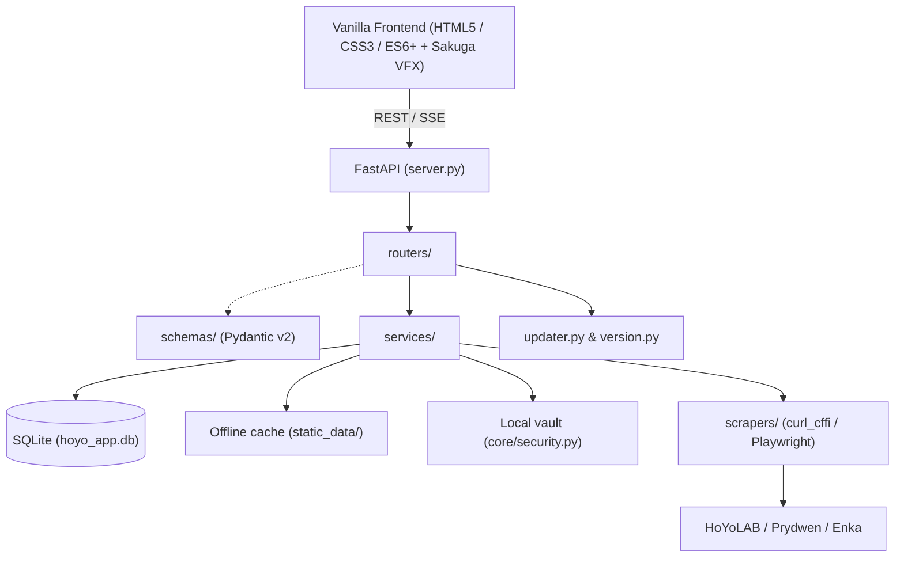

# Cabeça de Droid

<p align="center">
  <b>Language / Idioma:</b> <a href="README.md">🇧🇷 Português (Brasil)</a> | <a href="README.en.md">🇺🇸 English</a>
</p>

[](https://www.python.org/)
[](https://fastapi.tiangolo.com/)
[-ff477e.svg)](static/vendor/sakuga-vfx/)
[](LICENSE)
[](tests/)
[](SECURITY.md)

**Cabeça de Droid** is a local app for analyzing builds, tracking gacha, and organizing daily farming across **Honkai: Star Rail**, **Genshin Impact**, and **Zenless Zone Zero**. It combines automatic guide and tier list collection, gear Roll Value (RV) calculation, a gacha simulator (10,000 runs), an offline **Sakuga VFX** web UI, and a Windows standalone executable with GitHub Releases auto-updating.

> [!NOTE]
> **Name origin:** "Cabeça de Droid" (Droid Head) comes from *Honkai: Star Rail* lore: Herta's nickname for **Nous**, the Aeon of Erudition.

---

## How to download and run on Windows (`.exe`)

If you just want to run the app on Windows without setting up a dev environment:

1. Download **`Cabeca_de_Droid-Windows-x64.zip`** from **[GitHub Releases](https://github.com/Lacas0010/Cabeca_de_Droid/releases)**.
2. Extract the `.zip` into any folder (e.g., `C:\Games\Cabeca_de_Droid`).
3. Double-click **`Cabeca_de_Droid.exe`**.
   - The app starts on `http://127.0.0.1:8000`, adds a Windows system tray icon, and opens in your default browser.
   - Your SQLite database, encrypted cookies, cache, and logs live in `%APPDATA%\Cabeca_de_Droid`.
   - Closing all open browser tabs automatically stops the background server in `.exe` mode. When a new GitHub release drops, the updater downloads the `.zip`, keeps your local data intact, and restarts the app.
   - *(Optional)* Rename `.env.example` to `.env` next to the `.exe` to customize `HOST`, `PORT`, or `ALLOW_LAN`.

> [!IMPORTANT]
> **Windows SmartScreen warning:** Since this open-source `.exe` isn't signed with a paid Microsoft certificate, SmartScreen may show *"Windows protected your PC"*. Click **"More info"** and then **"Run anyway"**.

*(To run from source with Python/Git or self-host on Linux/Docker, see sections [4](#4-developer-setup) and [5](#5-self-hosted-deployment).)*

---

## 1. Features

- **Automatic guide and banner collection:** Pulls character guides, tier lists, and recommended builds from Prydwen, Enka Network, and HoYoLAB (using `curl_cffi` to get past 403 CDN blocks), plus active banners (*Epitome Invocation*, *Brilliant Fixation*, *Dissonant Sonata*) saved to `static_data/current_banners.json`. Works offline from local JSON caches whenever needed.
- **Roll Value (RV) calculation:** Scores HSR Relics and Planar Ornaments, Genshin Artifacts (Flower, Plume, Sands, Goblet, Circlet), and ZZZ Drive Discs (Slots 1–6) against recommended main stats and substat priorities.
- **Gacha simulator, forecast & pull tracker:** Runs 10,000 simulations for characters (C0–C6 / E0–E6 / M0–M6) and weapons/light cones/W-Engines (R1–R5) using real Soft Pity curves (pull 74 for characters, 63 for Genshin weapons, 65 for HSR Light Cones), 50/50 guarantees, Epitomized Path, and Fate Points. Tracks banner countdown goals and imports/exports Warp, Wish, and Signal logs in UIGF and SRGF formats.
- **Daily farming & 3-game summary:** Maps open daily domains for Talent books, weapon materials, and Traces, prioritizes Resin / Trailblaze Power / Battery spending, and builds a daily summary across all 3 games with optional Discord and Telegram delivery.
- **Trash finder & crafting advisor:** Highlights unused pieces with bad substat spreads and suggests where to spend *Self-Modeling Resin* (HSR), *Sanctifying Elixir* (Genshin), and Drive Disc *Tuning* (ZZZ).
- **Luck index & 2x HD cards:** Tracks overall roll quality, picks your **God Roll** and **Cursed Roll**, and exports single or 3/4-slot team cards as `2400 × 1350 px` PNGs.
- **Endgame & team matcher:** Tracks clears in *Memory of Chaos (MoC)*, *Pure Fiction (PF)*, *Apocalyptic Shadow (AS)*, *Spiral Abyss*, *Imaginarium Theater*, *Shiyu Defense*, and *Deadly Assault*, supports HSR alternate paths / extra Eidolons, and recommends teams with viable substitutes from your roster.
- **Snapshots, promo codes & auto-login:** Saves account progression snapshots, checks and redeems promo codes every 3 hours, and captures HoYoLAB cookies via Playwright (falling back to installed Chrome or Edge if needed).
- **Local cookie protection:** Encrypts `ltuid_v2`, `ltoken_v2`, and `cookie_token_v2` using Windows DPAPI or AES-256-GCM on Linux, masks tokens in HTTP responses and logs (`mask_token`), binds to `127.0.0.1` by default, and supports an optional PBKDF2 PIN lock.
- **Offline PT-BR / EN-US UI:** Ships 11 local **Sakuga VFX** Web Components (`static/vendor/sakuga-vfx/`), local WOFF2 fonts, grid/list roster views, audit filters, and instant language switching.

---

## 2. How Roll Value (RV) calculation works

### 2.1 Basic formula and weights

For each substat, Roll Value divides the rolled value by the maximum single roll of a 5★ / S-Rank piece:

```text
RV_substat = rolled_value / max_5star_roll
Piece_score = sum(RV_substat * weight_W)
```

Weights `W` follow the build's substat priority:
- **Priority 1:** `1.00`
- **Priority 2:** `0.85`
- **Priority 3:** `0.70`
- **Priority 4:** `0.55`
- **Priority 5:** `0.40`
- **Other substats:** `0.30`
- **Flat stats:** Flat ATK, Flat HP, and Flat DEF get `50%` of the weight of their percentage counterpart when prioritized.

### 2.2 Main stat bonus

- **Recommended main stat:** `+40%` base credit.
- **Viable alternative:** `+24%` base credit.
- **Incompatible main stat:** `0%` base credit.
- **Fixed main stat slots (Flower/Plume in Genshin, Head/Hands in HSR, Discs 1/2/3 in ZZZ):** `30%` fixed + `70%` from substats.

### 2.3 Overall build score and grades

```text
Build_score = sum(equipped_piece_scores) / total_slots
```
*(6 slots for HSR and ZZZ; 5 slots for Genshin Impact.)*

| Grade | Score | Meaning |
| :---: | :---: | :--- |
| **SSS** | `>= 90.0%` | Near-perfect rolls on the right substats |
| **SS** | `75.0% - 89.9%` | Heavy investment, minimal wasted rolls |
| **S** | `60.0% - 74.9%` | Endgame ready |
| **A** | `45.0% - 59.9%` | Solid working build, room to upgrade |
| **B** | `30.0% - 44.9%` | Transitional gear |
| **C** | `15.0% - 29.9%` | Wrong main stats or weak substats |
| **D** | `< 15.0%` | Replace when possible |

### 2.4 Reference 5★ / S-Rank roll values

#### Honkai: Star Rail (5★ Relics & Planar Ornaments)

| Substat | Min Roll | Avg Roll | Max Roll (1.0 RV) |
| :--- | :---: | :---: | :---: |
| **CRIT Rate** | 2.59% | 2.91% | 3.24% |
| **CRIT DMG** | 5.18% | 5.83% | 6.48% |
| **SPD** | 2.00 | 2.30 | 2.60 |
| **Break Effect** | 5.18% | 5.83% | 6.48% |
| **Effect Hit Rate (EHR)** | 3.45% | 3.88% | 4.32% |
| **Effect RES** | 3.45% | 3.88% | 4.32% |
| **ATK% / HP%** | 3.45% | 3.88% | 4.32% |
| **DEF%** | 4.32% | 4.86% | 5.40% |
| **Flat ATK / Flat DEF** | 17.00 | 19.15 | 21.30 |
| **Flat HP** | 33.80 | 38.05 | 42.30 |

#### Genshin Impact (5★ Artifacts)

| Substat | Min Roll | Avg Roll | Max Roll (1.0 RV) |
| :--- | :---: | :---: | :---: |
| **CRIT Rate** | 2.72% | 3.30% | 3.89% |
| **CRIT DMG** | 5.44% | 6.61% | 7.77% |
| **Energy Recharge** | 4.53% | 5.51% | 6.48% |
| **Elemental Mastery** | 16.32 | 19.82 | 23.31 |
| **ATK% / HP%** | 4.08% | 4.96% | 5.83% |
| **DEF%** | 5.10% | 6.20% | 7.29% |
| **Flat ATK** | 13.62 | 16.54 | 19.45 |
| **Flat HP** | 209.13 | 253.94 | 298.75 |
| **Flat DEF** | 16.20 | 19.68 | 23.15 |

#### Zenless Zone Zero (S-Rank Drive Discs)

| Substat | Min Roll | Avg Roll | Max Roll (1.0 RV) |
| :--- | :---: | :---: | :---: |
| **CRIT Rate** | 2.40% | 2.70% | 3.00% |
| **CRIT DMG** | 4.80% | 5.40% | 6.00% |
| **PEN** | 9.00 | 10.50 | 12.00 |
| **Anomaly Proficiency** | 9.00 | 10.50 | 12.00 |
| **ATK% / HP%** | 2.40% | 2.70% | 3.00% |
| **DEF%** | 3.84% | 4.32% | 4.80% |
| **Flat ATK / Flat DEF** | 15.00 | 17.50 | 20.00 |
| **Flat HP** | 90.00 | 102.50 | 115.00 |

---

## 3. Architecture



- **Backend:** Python 3.10+, FastAPI, Pydantic v2, Uvicorn, `httpx`, `packaging`, with math helpers in `calculators/`.
- **Scrapers:** `curl_cffi`, BeautifulSoup4, `genshin`, `rapidfuzz`, Playwright.
- **Storage:** SQLite (15 tables documented in [docs/db_schema.md](docs/db_schema.md)) + JSON files in `static_data/`.
- **Windows build:** `pyinstaller`, `pystray`, `Pillow`, workflow in [.github/workflows/release.yml](.github/workflows/release.yml).
- **Frontend:** HTML5, CSS3 (`:root` + `static/css/`), ES6 modules in `static/js/modules/`, and **Sakuga VFX** Web Components in `static/vendor/sakuga-vfx/`.

---

## 4. Developer setup

Requirements: Python 3.10+, Git, and Chromium (via Playwright).

```bash
git clone https://github.com/Lacas0010/Cabeca_de_Droid.git
cd Cabeca_de_Droid

python -m venv .venv
# Windows PowerShell: .\.venv\Scripts\Activate.ps1
# Linux / macOS:      source .venv/bin/activate

pip install -r requirements.txt
playwright install chromium

python main.py
```

Open `http://127.0.0.1:8000` in your browser.

To build the Windows ZIP locally into `dist/Cabeca_de_Droid-Windows-x64.zip`:

```bash
python build.py
```

---

## 5. Self-hosted deployment

### 5.1 Systemd (Linux)

Create `/etc/systemd/system/cabeca-de-droid.service` (template in [scripts/cabeca-de-droid.service](scripts/cabeca-de-droid.service)):

```ini
[Unit]
Description=Cabeca de Droid
After=network.target

[Service]
Type=simple
User=ubuntu
WorkingDirectory=/home/ubuntu/Cabeca_de_Droid
ExecStart=/home/ubuntu/Cabeca_de_Droid/.venv/bin/python main.py --host 0.0.0.0 --port 8000 --no-browser
Restart=always
RestartSec=5
Environment=PYTHONUNBUFFERED=1

[Install]
WantedBy=multi-user.target
```

```bash
sudo systemctl daemon-reload
sudo systemctl enable --now cabeca-de-droid
```

### 5.2 Docker

```dockerfile
FROM python:3.11-slim

WORKDIR /app

RUN apt-get update && apt-get install -y --no-install-recommends \
    curl git && \
    rm -rf /var/lib/apt/lists/*

COPY requirements.txt .
RUN pip install --no-cache-dir -r requirements.txt && \
    playwright install-deps chromium && \
    playwright install chromium

COPY . .

EXPOSE 8000
CMD ["python", "main.py", "--host", "0.0.0.0", "--port", "8000", "--no-browser"]
```

```bash
docker build -t cabeca-de-droid .
docker run -d -p 8000:8000 -v $(pwd)/hoyo_app.db:/app/hoyo_app.db cabeca-de-droid
```

---

## 6. CLI flags

| Flag | Type | Default | What it does |
| :--- | :---: | :---: | :--- |
| `--host` | `str` | `127.0.0.1` | Host interface (`0.0.0.0` exposes to LAN). |
| `--port` | `int` | `8000` | Listening HTTP port. |
| `--lan` | `flag` | `False` | Shortcut for `--host 0.0.0.0`. |
| `--no-browser` | `flag` | `False` | Skips auto-opening the browser on startup. |
| `--no-tray` | `flag` | `False` | Disables the Windows system tray icon. |

---

## 7. Main REST endpoints

| Method | Endpoint | Description |
| :--- | :--- | :--- |
| `GET` | `/api/overview` | Accounts summary, stamina counters, and rosters across all 3 games. |
| `GET` | `/api/roster/{game_id}` | Character roster with RV scores and gear grades. |
| `GET` | `/api/build/{game_id}/{char_name}` | Gear breakdown, weapons/cones/W-Engines, and Traces/Talents. |
| `GET` | `/api/compare/{game_id}/{char_name}` | Build comparison against community recommendations. |
| `POST` | `/api/sync/{game_id}` / `/api/sync/all` | Runs background roster and local data sync. |
| `GET` | `/api/endgame/{game_id}` | MoC, PF, AS, Spiral Abyss, Theater, Shiyu Defense, and Deadly Assault clears. |
| `GET` | `/api/endgame/team-match/{game_id}` | Team suggestions and viable substitutes based on your roster. |
| `GET` | `/api/strategy/account-gaps/{game_id}` | Missing elements and combat roles on the account. |
| `GET` / `POST` | `/api/gacha/current-banners` & `/sync` | Fetches or refreshes active banners from Prydwen. |
| `GET` | `/api/gacha/defaults/{game_id}` | Current pity, guarantee state, and simulator defaults. |
| `POST` | `/api/gacha/calculate` | Gacha simulation (10,000 runs). |
| `POST` | `/api/gacha/forecast/calculate` | Pull accumulation projection for upcoming banners. |
| `GET` / `POST` | `/api/gacha/goals` | Lists and saves banner goals in SQLite. |
| `GET` / `POST` | `/api/gacha/tracker/{game_id}` & `/import` | Warp/Wish/Signal history and UIGF/SRGF import. |
| `GET` | `/api/farming/today` | Open domains today and prioritized farm list. |
| `GET` | `/api/trash/{game_id}` | Inventory gear candidates for salvage. |
| `GET` | `/api/relics/craft-recommendations/{game_id}` | Suggestions for Self-Modeling Resin, Sanctifying Elixir, and Drive Disc tuning. |
| `GET` | `/api/luck/{game_id}` | Account luck score, God Roll, and Cursed Roll. |
| `GET` | `/api/notes` | Resin, Trailblaze Power, Battery, and expedition timers. |
| `POST` | `/api/checkin/run` | Runs HoYoLAB daily check-in. |
| `GET` | `/api/briefing/today` | Daily summary across all 3 games. |
| `GET` / `POST` | `/api/history/{game_id}` & `/snapshot` | Paginated snapshot timeline and manual snapshot creation. |
| `GET` | `/api/codes` & `/history/{game_id}` | Active promo codes and redemption log. |
| `GET` | `/api/proxy_image` | Local image proxy with LANCZOS resizing and WebP caching. |
| `GET` / `POST` | `/api/static-data/status` & `/sync` | Status and refresh of `static_data/` JSON caches. |
| `GET` / `POST` | `/api/updater/check`, `/start`, `/status` | GitHub Releases check, download, and update progress. |
| `POST` | `/api/system/heartbeat` & `/disconnect` | Tracks open tabs to shut down `.exe` cleanly on exit. |

---

## 8. Bundled frontend libraries

All frontend assets live locally under `static/vendor/` so the app runs offline without external CDNs:
- **[Sakuga VFX](https://github.com/finktheartist/sakuga-vfx)**: animated Web Components.
- **FontAwesome**, **Marked.js**, **html2canvas**, and **Inter / Outfit** fonts.

---

## 9. License, tests & security

- **License:** [MIT](LICENSE).
- **Tests:** Pull requests to `main` must pass `python -m unittest discover tests`. Optional lint/type config is in [pyproject.toml](pyproject.toml). See [CONTRIBUTING.md](CONTRIBUTING.md).
- **Security:** Vault details and vulnerability reporting are in [SECURITY.md](SECURITY.md).
