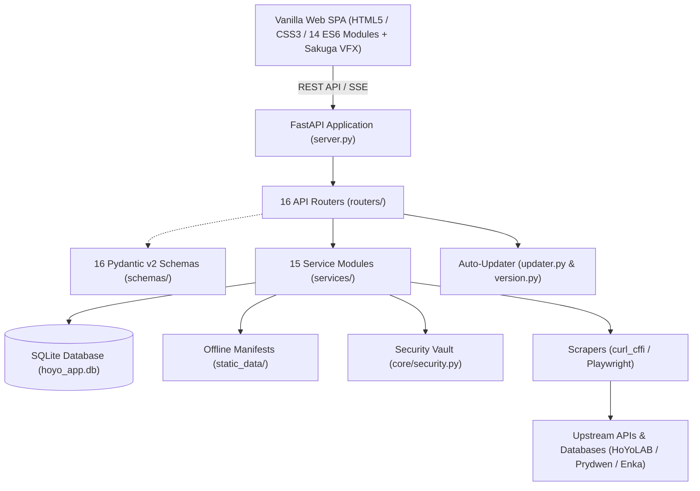

# Cabeça de Droid

<p align="center">
  <b>Language / Idioma:</b> <a href="README.md">🇧🇷 Português (Brasil)</a> | <a href="README.en.md">🇺🇸 English</a>
</p>

[](https://www.python.org/)
[](https://fastapi.tiangolo.com/)
[-ff477e.svg)](static/vendor/sakuga-vfx/)
[](LICENSE)
[](tests/)
[](SECURITY.md)

**Cabeça de Droid** is a local metagame analysis suite and multi-game account manager for **Honkai: Star Rail**, **Genshin Impact**, and **Zenless Zone Zero**. It combines automated metagame data ingestion, deterministic equipment Roll Value (RV) scoring, Monte Carlo gacha forecasting, an offline-first **Sakuga VFX** web interface, and a standalone Windows executable with **in-app GitHub Releases auto-updating**.

> [!NOTE]
> **Name Origin:** "Cabeça de Droid" (Droid Head) references *Honkai: Star Rail* lore — the epithet given by Herta to **Nous**, the Aeon of Erudition, an astronomical supercomputer elevated to divinity.

---

## How to Download & Run (Windows Standalone — No Python Required)

If you want to run **Cabeça de Droid** on Windows without installing Python, Git, or external dependencies:

1. Open the official **[GitHub Releases](https://github.com/Lacas0010/Cabeca_de_Droid/releases)** page.
2. In the latest release, download **`Cabeca_de_Droid-Windows-x64.zip`**.
3. Extract the `.zip` archive to a folder of your choice (e.g., `C:\Games\Cabeca_de_Droid`).
4. Double-click **`Cabeca_de_Droid.exe`**.
   - The app starts locally with a Windows System Tray icon and automatically opens `http://127.0.0.1:8000` in your default browser.
   - Your personal data (SQLite database, encrypted credential vault, caches, and logs) is stored safely in `%APPDATA%\Cabeca_de_Droid`.
   - **Auto-Shutdown on Window Close:** In packaged desktop builds (`.exe`), closing all open Cabeça de Droid browser tabs automatically shuts down the background server via client heartbeat + `sendBeacon` lifecycle tracking (self-hosted/server launches stay online continuously).
   - **In-App Auto-Updater:** On startup (or via the sidebar version badge / **Atualizar** button), the app checks GitHub Releases asynchronously and offers one-click downloading, ZipSlip-verified extraction, safe `.bat` replacement preserving your local database/vault/`.env`, and automatic restart.
   - *(Optional)* Rename `.env.example` to `.env` alongside the executable to customize `HOST`, `PORT`, or `ALLOW_LAN`.

> [!IMPORTANT]
> **Windows Defender SmartScreen Notice:**  
> Because this community open-source binary is not signed with a commercial Authenticode certificate, Windows SmartScreen may show *"Windows protected your PC"*. Click **"More info"** and then **"Run anyway"** to launch it.

*(Developers running from source via Python/Git or deploying on Linux/Docker can follow [Section 4](#4-prerequisites--developer-installation) and [Section 5](#5-self-hosted-deployment).)*

---

## 1. Core Modules & Features

### 1.1 Multi-Game Metagame Data Ingestion
- **Automated Upstream Scraping:** Uses `curl_cffi` with browser TLS/JA3 fingerprint impersonation to bypass 403 CDN protections, collecting character guides, equipment benchmarks, and rotation metrics from community sources (Prydwen, Enka Network, HoYoLAB).
- **Dynamic Character & Equipment Banner Scraping:** Parses live character and weapon banners (including *Epitome Invocation*, *Brilliant Fixation*, and *Dissonant Sonata*) for all three games into `static_data/current_banners.json`.
- **Deterministic Offline Cache:** Operates autonomously from local static JSON manifests when external network connectivity is unavailable.

### 1.2 Deterministic Gear Roll Value (RV) Engine
- **Cross-Game Gear Evaluation:**
  - *Honkai: Star Rail:* Evaluates Relics and Planar Ornaments against canonical 5★ roll limits.
  - *Genshin Impact:* Scores Artifacts (Flower, Plume, Sands, Goblet, Circlet) weighted by character scaling (ATK, HP, DEF, ER, EM, CRIT).
  - *Zenless Zone Zero:* Evaluates Drive Discs (Slots 1–6), main stats, Anomaly Proficiency, and CRIT spreads.
- **Weighted Role Prioritization:** Substats receive deterministic priority weights ($1.00$ down to $0.40$) derived from benchmark community guides.
- **Primary Stat Forgiveness:** Grants $+40\%$ baseline credit for recommended main stats, $+24\%$ for viable secondaries, and $0\%$ for incompatible types.
- **Flat Stat Fallback:** Flat ATK, Flat HP, and Flat DEF automatically receive $50\%$ of their corresponding percentage stat weight if the percentage variant is prioritized.

### 1.3 Monte Carlo Gacha Simulator, Forecast & History Tracker
- **10,000-Iteration Stochastic Modeling:** Simulates probability distributions, expected pull counts, and confidence intervals for target characters (C0–C6 / E0–E6 / M0–M6) and signature weapons/cones/engines (R1–R5).
- **Accurate Pity Curves:** Implements soft pity thresholds (pull 74 for character banners, pull 63 for Genshin weapons, pull 65 for HSR light cones), base rates, 50/50 guaranteed state tracking, and Epitomized Path / Fate Points rules.
- **Saved Banner Goals & Live Countdown:** Persists gacha targets in SQLite (`gacha_forecast_goals`) with second-by-second countdowns calibrated to official regional phase release schedules.
- **Warp / Wish / Signal Tracker:** Imports and exports pull logs via UIGF v2.4 and SRGF schemas with exact pity counters and historical luck scoring.

### 1.4 Daily Farming Planner (Work Order)
- **Domain Schedule Mapping:** Maps active talent books, weapon ascension domains, and trace materials according to server weekday rotation.
- **Roster-Prioritized Allocation:** Cross-references open domains against characters below investment thresholds to build prioritized stamina/resin/battery schedules.
- **Webhook Dispatch:** Exports or sends daily farming checklists directly to Discord Webhooks and Telegram Bots.

### 1.5 Equipment Discard Filter (Trash Finder) & Crafting Advisor
- **Inventory Discard Identification:** Audits unequipped and locked gear against every indexed character to spotlight conflicting substats or low Roll Value candidates for salvage.
- **Crafting Recommendation Engine:** Recommends targeted piece synthesis via *Self-Modeling Resin* (HSR), *Sanctifying Elixir* (Genshin), or *Tuning/Dismantling* (ZZZ) targeting active teams' weakest slots.

### 1.6 Account Roll Efficiency Index (Luck Score) & Programmatic Cards
- **Substat Quality Variance:** Compares observed substat rolls against canonical 5★ ceilings across equipped gear, identifying each account's **God Roll** and **Cursed Roll**.
- **2x HD Build & Team Card Export:** Renders 2400 × 1350 px character cards and 3/4-slot team showcase graphics locally via HTML5 Canvas (`html2canvas`) with one-click clipboard PNG copy.

### 1.7 Endgame Compatibility & Affinitive Eidolons
- **Combat Challenge Auditing:** Tracks clear stats across *Memory of Chaos (MoC)*, *Pure Fiction (PF)*, *Apocalyptic Shadow (AS)*, *Spiral Abyss*, *Imaginarium Theater*, and *Shiyu Defense* / *Deadly Assault*.
- **Affinitive Eidolons & Alternate Paths:** Supports HSR Affinitive/Extra Eidolon nodes (`ex_ranks_json`) and variant/Trailblazer resolution without MD5/name collisions.
- **Algorithmic Team Matcher:** Matches meta archetypes against SQLite roster ownership and suggests functional substitutions.

### 1.8 Account Evolution Timeline, Promo Codes & Auto-Login Fallback
- **Temporal Snapshots:** Saves periodic snapshots (`account_snapshots`) and calculates stat/build progression diffs over time.
- **Autonomous 3h Promo Code Redemption:** Scans and redeems Primogems, Stellar Jades, and Polychromes via official HoYoLAB endpoints, with desktop/Discord/Telegram alerts.
- **Resilient Browser Login:** Captures HoYoLAB cookies via Playwright using Chromium, automatically falling back to system-installed Google Chrome or Microsoft Edge in frozen builds if bundled Playwright browsers are absent.

### 1.9 Cryptographic Credential Vault & Zero-Exposure Security
- **Hardware-Backed / OS Vault:** Encrypts session cookies (`ltuid_v2`, `ltoken_v2`, `cookie_token_v2`) using Windows DPAPI (`CryptProtectData`) or AES-256-GCM / HMAC on POSIX hosts.
- **Privacy Enforcement:** Masks tokens in responses (`mask_token`), redacts credentials in real-time logs, defaults to `127.0.0.1` loopback binding, and supports optional PBKDF2-protected local PIN locking.

### 1.10 Sakuga VFX Offline-First Interface & Roster Workspace
- **100% Local Sakuga VFX Web Components (`static/vendor/sakuga-vfx/`):** Native zero-dependency custom elements (`<sakuga-button>`, `<sakuga-toggle>`, `<sakuga-slider>`, `<sakuga-checkbox>`, `<sakuga-radio>`, `<sakuga-input>`, `<sakuga-tabs>`, `<sakuga-progress>`, `<sakuga-rating>`, `<sakuga-toast>`, `<sakuga-tooltip>`) bundled locally for full offline operation.
- **Bilingual UI (PT-BR / EN-US):** Live client/backend localization across all tabs, stats, endgame modes, and farm calendars (`i18n.js` + `translation_service.py`).
- **Flexible Grid & High-Density List View:** Instant toggle (`localStorage`) between visual character cards and 5-column analytical rows showing weapon/relic canonical rarities, active set tags, RV grades, smart sorting (Power, RV, Level, A–Z/Z–A), audit filters, and debounced search (`AbortController`).
- **Desktop Multi-Column Settings & High-Performance Backend:** Horizontal grid cards on desktop (`> 768px`), GZip compression, 60s TTL service caching with sync invalidation, batch SQLite relic queries, WebP/LANCZOS `/api/proxy_image`, and self-hosted WOFF2 fonts (`Inter` & `Outfit`).

### 1.11 In-App GitHub Releases Auto-Updater
- **Single-Source Versioning (`version.py`):** Automatically stamped by CI tag triggers (`v*.*.*`) before building Windows binaries.
- **Safe Windows Replacement (`updater.py` & `routers/updater.py`):** Performs 5-second non-blocking startup checks against GitHub Releases API, streams `.zip` updates with progress tracking (`0.0`–`1.0`), enforces GitHub domain allowlists and ZipSlip checks, swaps binaries safely via a detached `%TEMP%` `.bat` waiting on PID exit without overwriting user DBs/vault/`.env`, and restarts automatically.

---

## 2. Roll Value (RV) Calculation Methodology

### 2.1 Mathematical Formulation

The Roll Value of an individual substat roll is defined as the ratio between the observed numerical value and the maximum possible single roll value for a 5★ item:

$$RV_i = \frac{\text{Observed Substat Value}_i}{\text{Max 5★ Roll Value}_i}$$

Each piece is scored by summing the weighted Roll Values of its active substats:

$$\text{Piece Substat Score} = \sum_{i=1}^{n} \left( RV_i \times W_i \right)$$

Where $W_i \in [0.0, 1.0]$ represents the weight assigned to substat $i$ based on character path, scaling attributes, and archetype priority:
- **Priority 1 Substat:** $W = 1.00$
- **Priority 2 Substat:** $W = 0.85$
- **Priority 3 Substat:** $W = 0.70$
- **Priority 4 Substat:** $W = 0.55$
- **Priority 5 Substat:** $W = 0.40$
- **Secondary / Off-Stat:** $W = 0.30$
- **Flat Stat Fallback:** Flat ATK, Flat HP, and Flat DEF automatically receive $50\%$ of the corresponding percentage stat weight if the percentage variant is prioritized.

### 2.2 Primary Stat Forgiveness
- **Recommended Primary Stat:** $+40\%$ baseline credit added to the piece rating.
- **Secondary / Viable Primary Stat:** $+24\%$ baseline credit.
- **Non-Viable Primary Stat:** $0\%$ baseline credit.
- **Fixed Primary Slots:** Base credit is fixed at $30\%$, with the remaining $70\%$ allocated to substat evaluation.

### 2.3 Account Build Score
The overall build score evaluates all designated equipment slots ($N_{\text{slots}} = 6$ for HSR and ZZZ, $N_{\text{slots}} = 5$ for Genshin Impact):

$$\text{Overall Build Score} = \frac{\sum_{k=1}^{N_{\text{equipped}}} \text{Piece Score}_k}{N_{\text{total slots}}}$$

### 2.4 Rating Scale

| Grade | Score Interval | Classification Criteria |
| :---: | :---: | :--- |
| **SSS** | $\ge 90.0\%$ | Optimal rolls across all priority stats; maximum substat efficiency |
| **SS** | $75.0\% - 89.9\%$ | High-investment build; minimal stat wastage |
| **S** | $60.0\% - 74.9\%$ | Endgame battle-ready benchmark |
| **A** | $45.0\% - 59.9\%$ | Functional build; acceptable substat spread |
| **B** | $30.0\% - 44.9\%$ | Transitional gear; missing core rolls |
| **C** | $15.0\% - 29.9\%$ | Low efficiency; incorrect main stats or rolls |
| **D** | $< 15.0\%$ | Unviable build; candidate for immediate salvage |

### 2.5 Canonical 5★ Substat Roll Baselines

#### Honkai: Star Rail (5★ Relics)

| Substat | Minimum Roll | Average Roll | Maximum Roll (1.0 RV) |
| :--- | :---: | :---: | :---: |
| **CRIT Rate** | 2.59% | 2.91% | 3.24% |
| **CRIT DMG** | 5.18% | 5.83% | 6.48% |
| **SPD** | 2.00 | 2.30 | 2.60 |
| **Break Effect** | 5.18% | 5.83% | 6.48% |
| **Effect Hit Rate (EHR)** | 3.45% | 3.88% | 4.32% |
| **Effect RES** | 3.45% | 3.88% | 4.32% |
| **ATK% / HP%** | 3.45% | 3.88% | 4.32% |
| **DEF%** | 4.32% | 4.86% | 5.40% |
| **Flat ATK / Flat DEF** | 17.00 | 19.15 | 21.30 |
| **Flat HP** | 33.80 | 38.05 | 42.30 |

#### Genshin Impact (5★ Artifacts)

| Substat | Minimum Roll | Average Roll | Maximum Roll (1.0 RV) |
| :--- | :---: | :---: | :---: |
| **CRIT Rate** | 2.72% | 3.30% | 3.89% |
| **CRIT DMG** | 5.44% | 6.61% | 7.77% |
| **Energy Recharge** | 4.53% | 5.51% | 6.48% |
| **Elemental Mastery** | 16.32 | 19.82 | 23.31 |
| **ATK% / HP%** | 4.08% | 4.96% | 5.83% |
| **DEF%** | 5.10% | 6.20% | 7.29% |
| **Flat ATK** | 13.62 | 16.54 | 19.45 |
| **Flat HP** | 209.13 | 253.94 | 298.75 |
| **Flat DEF** | 16.20 | 19.68 | 23.15 |

#### Zenless Zone Zero (S-Rank Drive Discs)

| Substat | Minimum Roll | Average Roll | Maximum Roll (1.0 RV) |
| :--- | :---: | :---: | :---: |
| **CRIT Rate** | 2.40% | 2.70% | 3.00% |
| **CRIT DMG** | 4.80% | 5.40% | 6.00% |
| **PEN** | 9.00 | 10.50 | 12.00 |
| **Anomaly Proficiency** | 9.00 | 10.50 | 12.00 |
| **ATK% / HP%** | 2.40% | 2.70% | 3.00% |
| **DEF%** | 3.84% | 4.32% | 4.80% |
| **Flat ATK / Flat DEF** | 15.00 | 17.50 | 20.00 |
| **Flat HP** | 90.00 | 102.50 | 115.00 |

---

## 3. Architecture & Technologies



### Component Stack
- **Backend Framework:** Python 3.10+, FastAPI, Pydantic v2, Uvicorn, `httpx`, `packaging`.
- **Ingestion & Web Scraping:** `curl_cffi` (browser TLS/JA3 impersonation), BeautifulSoup4, `genshin`, `rapidfuzz`, Playwright (Chromium + system Chrome/Edge fallback).
- **Persistence & Caching:** SQLite (`hoyo_app.db` — 15 tables documented in [docs/db_schema.md](docs/db_schema.md)) + offline static JSON manifests (`static_data/`).
- **Desktop Packaging & Tray:** `pyinstaller`, `pystray`, `Pillow`, `core/paths.py` (`sys._MEIPASS` & `%APPDATA%`), automated CI via [.github/workflows/release.yml](.github/workflows/release.yml).
- **Security:** Windows DPAPI (`ctypes.windll.crypt32`) + AES-256-GCM / HMAC on POSIX.
- **Frontend:** Vanilla HTML5, CSS3 custom properties (`--sk-*` + `:root`), 14 modular ES6 files, and 11 offline **Sakuga VFX** Web Components (`static/vendor/sakuga-vfx/`).

---

## 4. Prerequisites & Developer Installation

### Requirements
- Python 3.10 or higher
- Git
- Chromium (installed via Playwright)

### Quick Setup

```bash
# 1. Clone repository
git clone https://github.com/Lacas0010/Cabeca_de_Droid.git
cd Cabeca_de_Droid

# 2. Configure virtual environment
python -m venv .venv

# Windows PowerShell:
.\.venv\Scripts\Activate.ps1
# Linux / macOS:
source .venv/bin/activate

# 3. Install dependencies
pip install -r requirements.txt
playwright install chromium

# 4. Launch web service
python main.py
```

Default access URL: `http://127.0.0.1:8000`

### Building the Windows Standalone ZIP Locally
```bash
python build.py
```
Outputs the portable executable and `dist/Cabeca_de_Droid-Windows-x64.zip` (verifying bundled Sakuga VFX assets automatically before compilation).

---

## 5. Self-Hosted Deployment

### 5.1 Systemd Service (Linux)

Create `/etc/systemd/system/cabeca-de-droid.service` (or use [scripts/cabeca-de-droid.service](scripts/cabeca-de-droid.service)):

```ini
[Unit]
Description=Cabeca de Droid Metagame Service
After=network.target

[Service]
Type=simple
User=ubuntu
WorkingDirectory=/home/ubuntu/Cabeca_de_Droid
ExecStart=/home/ubuntu/Cabeca_de_Droid/.venv/bin/python main.py --host 0.0.0.0 --port 8000 --no-browser
Restart=always
RestartSec=5
Environment=PYTHONUNBUFFERED=1

[Install]
WantedBy=multi-user.target
```

Enable and start the service:

```bash
sudo systemctl daemon-reload
sudo systemctl enable cabeca-de-droid
sudo systemctl start cabeca-de-droid
```

### 5.2 Container Deployment (OCI / Docker)

```dockerfile
FROM python:3.11-slim

WORKDIR /app

RUN apt-get update && apt-get install -y --no-install-recommends \
    curl git && \
    rm -rf /var/lib/apt/lists/*

COPY requirements.txt .
RUN pip install --no-cache-dir -r requirements.txt && \
    playwright install-deps chromium && \
    playwright install chromium

COPY . .

EXPOSE 8000

CMD ["python", "main.py", "--host", "0.0.0.0", "--port", "8000", "--no-browser"]
```

Build and run:

```bash
docker build -t cabeca-de-droid .
docker run -d -p 8000:8000 -v $(pwd)/hoyo_app.db:/app/hoyo_app.db cabeca-de-droid
```

---

## 6. Configuration & CLI Parameters

| Parameter | Type | Default | Description |
| :--- | :---: | :---: | :--- |
| `--host` | `str` | `127.0.0.1` | Network interface binding (`0.0.0.0` for LAN access). |
| `--port` | `int` | `8000` | TCP listening port. |
| `--lan` | `flag` | `False` | Shortcut to bind `--host 0.0.0.0`. |
| `--no-browser` | `flag` | `False` | Disables automated browser launch on application startup. |
| `--no-tray` | `flag` | `False` | Disables Windows system tray taskbar icon integration. |

---

## 7. REST API Reference

| Method | Endpoint | Description |
| :--- | :--- | :--- |
| `GET` | `/api/overview` | Unified account metadata, stamina levels, and active rosters across all 3 games. |
| `GET` | `/api/roster/{game_id}` | Full character roster with computed Roll Value and gear grades. |
| `GET` | `/api/build/{game_id}/{char_name}` | Equipment breakdown, skills, traces/talents, and progression tiers. |
| `GET` | `/api/compare/{game_id}/{char_name}` | Deterministic build audit against community benchmark targets. |
| `POST` | `/api/sync/{game_id}` | Triggers background synchronization of roster and guide manifests. |
| `POST` | `/api/sync/all` | Triggers unified global synchronization across all configured games. |
| `GET` | `/api/endgame/{game_id}` | Cleared stages, star counts, and cycle metrics for endgame modes. |
| `GET` | `/api/endgame/team-match/{game_id}` | Archetype team compatibility calculations and substitute ranking. |
| `GET` | `/api/strategy/account-gaps/{game_id}` | Deterministic coverage diagnostics across elements and combat roles. |
| `GET` | `/api/gacha/current-banners` | Active character and weapon banners dynamically ingested from Prydwen. |
| `POST` | `/api/gacha/current-banners/sync` | Forces real-time scraping of current character and weapon banners. |
| `GET` | `/api/gacha/defaults/{game_id}` | Default simulator parameters (pity, guaranteed state, active banner item). |
| `POST` | `/api/gacha/calculate` | Monte Carlo gacha probability calculation (10,000 iterations). |
| `POST` | `/api/gacha/forecast/calculate` | Pull accumulation projections and target milestone forecasting. |
| `GET` / `POST` | `/api/gacha/goals` | Manages persisted banner goals and live countdown targets. |
| `GET` | `/api/gacha/tracker/{game_id}` | Warp/Wish/Signal logs, history distribution, and pity analytics. |
| `POST` | `/api/gacha/tracker/import` | Standard UIGF v2.4 / SRGF warp log import. |
| `GET` | `/api/farming/today` | Active material domains and prioritized stamina allocation work order. |
| `GET` | `/api/trash/{game_id}` | Discard filter identifying conflicting or low-RV inventory gear. |
| `GET` | `/api/relics/craft-recommendations/{game_id}` | Synthesis priorities for Resin, Elixir, and Drive Disc tuning. |
| `GET` | `/api/luck/{game_id}` | Account roll efficiency metrics, God Roll and Cursed Roll identification. |
| `GET` | `/api/notes` | Real-time stamina, daily quest, and expedition counters. |
| `POST` | `/api/checkin/run` | Executes HoYoLAB daily check-in sequence. |
| `GET` | `/api/briefing/today` | Unified 3-game executive daily briefing summary. |
| `GET` | `/api/history/{game_id}` | Paginated timeline of account progression snapshots (`?limit=50&offset=0`). |
| `POST` | `/api/history/{game_id}/snapshot` | Manually records an account progression snapshot. |
| `GET` | `/api/codes` | Active promotional codes with redemption history and auto-redeem status. |
| `GET` | `/api/codes/history/{game_id}` | Paginated redemption log for promotional codes (`?limit=50&offset=0`). |
| `GET` | `/api/proxy_image` | High-performance image proxy with on-demand LANCZOS resizing and WebP conversion. |
| `GET` / `POST` | `/api/static-data/status` & `/sync` | Status and live synchronization of offline JSON manifests. |
| `GET` | `/api/updater/check` | Non-blocking GitHub Releases semantic version check and Windows `.zip` resolution. |
| `POST` | `/api/updater/start` | Starts background `.zip` download & safe binary swap (`dev_mode` notice when unfrozen). |
| `GET` | `/api/updater/status` | Live progress (`0.0`–`1.0`) and stage polling for the in-app updater modal. |
| `POST` | `/api/system/heartbeat` & `/disconnect` | Browser tab lifecycle tracking for safe auto-shutdown in `.exe` mode. |

---

## 8. Bundled Frontend Libraries & Credits

To guarantee 100% offline execution inside standalone builds, frontend vendor libraries are bundled locally under `static/vendor/`:
- **[Sakuga VFX](https://github.com/finktheartist/sakuga-vfx)** — Native animated Web Components.
- **FontAwesome**, **Marked.js**, **html2canvas**, and self-hosted **Inter / Outfit** WOFF2 fonts.

---

## 9. License & Contributing

- **License:** Distributed under the [MIT License](LICENSE).
- **Contributing:** Pull requests targeting `main` must pass the offline unit test suite (`python -m unittest discover tests` — currently **231 tests**). Optional static checks (`ruff`, `mypy`) configured in [pyproject.toml](pyproject.toml) are also recommended. See [CONTRIBUTING.md](CONTRIBUTING.md) for architecture and frontend rules.
- **Security Disclosures:** Refer to [SECURITY.md](SECURITY.md) for cryptographic vault, updater verification, and vulnerability handling details.
