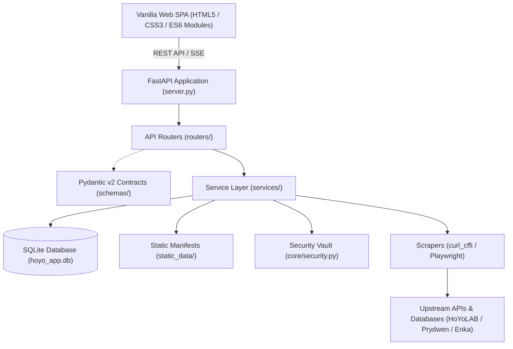

# Cabeça de Droid

<p align="center">
  <b>Language / Idioma:</b> <a href="README.md">🇺🇸 English</a> | <a href="README.pt-BR.md">🇧🇷 Português (Brasil)</a>
</p>

[](https://www.python.org/)
[](https://fastapi.tiangolo.com/)
[](LICENSE)
[](tests/)
[](SECURITY.md)
[](#112-high-performance-engine--optimization-pipeline)

Cabeça de Droid is a local metagame analysis service and multi-game management application for **Honkai: Star Rail**, **Genshin Impact**, and **Zenless Zone Zero** that provides automated metagame data ingestion, deterministic gear Roll Value (RV) evaluation, Monte Carlo gacha probability forecasting, and programmatic build audit rendering.

> [!NOTE]
> **Name Origin:** "Cabeça de Droid" (Droid Head) references *Honkai: Star Rail* lore — the title given by Herta to the **Aeon Nous** (the Aeon of Erudition), an astronomical supercomputer elevated to divinity.

---

## 1. Core Modules & Features

### 1.1 Multi-Game Metagame Data Ingestion
- **Automated Upstream Scraping:** Uses `curl_cffi` with browser TLS/JA3 fingerprint impersonation to bypass 403 CDN protections, scraping character guides, gear tier lists, and rotation metrics from community databases (Prydwen, Enka Network, HoYoLAB).
- **Dynamic Character & Equipment Banner Scraping:** Parses live character and weapon banners (including *Epitome Invocation*, *Brilliant Fixation*, and *Dissonant Sonata*) for all three games in real time, saving normalized data into offline JSON manifests under `static_data/current_banners.json`.
- **Deterministic Offline Cache:** System automatically operates from local static manifests when external network connectivity is unavailable.

### 1.2 Deterministic Gear Roll Value (RV) Engine
- **Cross-Game Gear Evaluation:**
  - *Honkai: Star Rail:* Evaluates Relics and Planar Ornaments against 5★ canonical roll limits.
  - *Genshin Impact:* Scores Artifacts (Flower, Plume, Sands, Goblet, Circlet) weighted by character scaling (ATK, HP, DEF, ER, EM, CRIT).
  - *Zenless Zone Zero:* Evaluates Drive Discs (Slots 1 to 6) evaluating main stats, anomaly proficiency, and CRIT spreads.
- **Weighted Role Prioritization:** Substats receive deterministic priority weights ($1.00$ down to $0.40$) derived from benchmark community guides.
- **Primary Stat Forgiveness:** Grants $+40\%$ baseline credit for recommended main stats, $+24\%$ for viable secondaries, and $0\%$ for incompatible types.
- **Flat Stat Fallback:** Flat ATK, Flat HP, and Flat DEF automatically receive $50\%$ of their corresponding percentage stat weight if the percentage variant is prioritized.

### 1.3 Monte Carlo Gacha Simulator & Pull Forecasting
- **10,000-Iteration Stochastic Modeling:** Simulates exact probability distributions, expected pull counts, and confidence intervals for target character copies (C0–C6 / E0–E6 / M0–M6) and signature weapons/cones/engines (R1–R5).
- **Accurate Engine Mechanics:** Implements official soft pity curves (starting at pull 74 for character banners, pull 63 for Genshin weapon banners, pull 65 for HSR light cone banners), base rates (0.6% / 0.8% / 1.0%), guaranteed 50/50 state tracking, and Fate Points / Epitomized Path rules.
- **Pull Accumulation Projection:** Projects daily and monthly currency earnings (Daily Commissions/Errands, Monthly Shop Resets, Spiral Abyss/MoC/Shiyu resets, events, and Express Supply Pass / Welkin Moon).
- **Warp / Wish / Signal History Tracker:** Imports and exports pull histories via UIGF v2.4 and SRGF standards, calculating exact account-level pity counters and historical luck percentages.

### 1.4 Daily Farming Planner (Work Order)
- **Domain Schedule Mapping:** Maps open talent, weapon ascension, and trace material domains in real time according to current server day.
- **Roster-Prioritized Allocation:** Cross-references open domains against characters below level/build thresholds in the user's active roster, generating prioritized stamina/resin/battery expenditure schedules.
- **Automated Work Order Export:** Copies or transmits daily farming itineraries formatted for Discord and Telegram webhooks.

### 1.5 Equipment Discard Filter (Trash Finder) & Crafting Advisor
- **Inventory Discard Identification:** Audits unequipped and locked gear against requirements of all indexed characters, identifying pieces with conflicting substats or low Roll Value for recycling into EXP or synthesis material.
- **Crafting Recommendation Engine:** Recommends targeted piece creation using *Self-Modeling Resin* (HSR), *Sanctifying Elixir* (Genshin), or *Tuning/Dismantling* (ZZZ) focused on the lowest-scoring equipment slots of active teams.

### 1.6 Account Roll Efficiency Index (Luck Score)
- **Statistical Substat Distribution:** Calculates account-wide roll quality metrics by measuring the variance between observed rolls and theoretical 5★ maximum values across all equipped pieces.
- **Record Identification:** Detects the account's top-performing equipment (**God Roll**) and lowest-efficiency piece (**Cursed Roll**).

### 1.7 Programmatic Tier List & Build Cards
- **Account Investment Matrix:** Classifies indexed rosters into standard grade tiers (**SSS** down to **D**) with elemental coverage and combat role distribution breakdowns.
- **2x HD Canvas Export:** Generates 2400 × 1350 px build cards, relic roll distributions, and team summaries locally via HTML5 Canvas with no third-party framework dependencies.

### 1.8 Endgame Compatibility & Team Matcher
- **Combat Challenge Auditing:** Tracks stages, clear times, cycle counts, and star ratings across *Memory of Chaos (MoC)*, *Pure Fiction (PF)*, *Apocalyptic Shadow (AS)*, *Spiral Abyss*, *Imaginarium Theater*, and *Shiyu Defense*.
- **Algorithmic Composition Matching:** Compares active meta team archetypes against user characters stored in SQLite, computing readiness percentages and recommending functional substitutions.

### 1.9 Account Evolution Timeline & Snapshot Diffing
- **Temporal Progression Tracking:** Stores periodic snapshots of roster stats, gear scores, and account levels.
- **Evolution Diffing:** Compares snapshot differentials to display stat increases, newly acquired 5★ items, and relic score progression over time.

### 1.10 Autonomous Code Redemption & Alerts
- **3-Hour Scheduled Redemption:** Searches and redeems active promo codes for Primogems, Stellar Jades, and Polychromes via official HoYoLAB endpoints.
- **Proactive Notifications:** Dispatches desktop toasts, Discord Webhook alerts, and Telegram Bot notifications when stamina caps, codes are redeemed, or banner rotations occur.

### 1.11 Cryptographic Credential Vault
- **Zero-Exposure Policy:** Protects session tokens (`ltuid_v2`, `ltoken_v2`) using Windows Data Protection API (DPAPI) or AES-256-GCM / HMAC on Linux.
- **Privacy Enforcement:** Tokens are masked in web interfaces (`mask_token`) and expunged from log outputs via regex sanitization. Optional local numeric PIN locks the web interface.

### 1.12 High-Performance Engine & Optimization Pipeline
- **HTTP / Network Layer:** `GZipMiddleware(minimum_size=1000)` compression, RFC-compliant `Cache-Control: public, max-age=86400` on static assets, and `CDN-Cache-Control` header (30 days) with production-ready reverse-proxy configuration (`scripts/nginx-cabeca-de-droid.conf`).
- **Database & Query Optimization:** Zero N+1 queries in SQLite (batch relic loading via `WHERE uid IN (...)`), explicit column projections replacing wildcard selects, and indexed temporal pagination (`LIMIT ? OFFSET ?`) across snapshots and redemption histories.
- **In-Memory TTL Caching:** Roster and Endgame service layers backed by a 60-second in-memory cache with reactive auto-invalidation on data synchronization, account deletion, and active profile changes.
- **Dynamic Image & Asset Pipeline:** On-demand WebP image conversion and Pillow LANCZOS resampling (`/api/proxy_image?w=160&format=webp`) yielding up to 95% payload savings, alongside local self-hosted WOFF2 fonts (`Inter`, `Outfit`) with `font-display: swap;`.
- **Vanilla Frontend Architecture:** Code-splitting with dynamic ES6 module loading (`requestIdleCallback`), native CSS list virtualization (`content-visibility: auto`) for large character galleries, and animated shimmer loading skeletons.
- **Latency Monitoring:** Profiling middleware tracking request durations, injecting `X-Process-Time` headers, and triggering `[PERF-WARN]` telemetry for requests exceeding 500 ms.

### 1.13 Flexible Character Roster View (Grid & Rich List Mode)
- **Seamless Grid / List Mode Toggle:** Instant view switching at the top of each game gallery with `localStorage` persistence (`roster_view_mode`), allowing users to toggle between visual card art (Grid view) and dense analytical rows (List view).
- **High-Density 5-Column List Row Architecture (Option C):**
  - **Character Identity:** Elemental-themed avatar badge, character level, ascension rank (`E0-E6`, `C0-C6`, `M0-M6`), and tactical combat path/weapon class.
  - **Weapon / Light Cone / W-Engine:** Official thumbnail, current weapon level, superimposition/refinement rank (`S1-S5`, `R1-R5`, `W1-W5`), and explicit canonical rarity badge (`5★`, `4★`, `3★`, `1★` or `Rank S / Rank A / Rank B`).
  - **Equipped Relics / Artifacts / Discs Strip:** Horizontal strip of official piece icons with borders and radial glows 100% faithful to canonical item rarity (Gold 5★, Purple 4★, Blue 3★), accompanied by corner micro-badges displaying roll evaluation grades (`SSS` through `D`).
  - **Active Set Bonuses:** Automatic parsing and display of active 4-piece and 2-piece set bonuses (`4p`, `2p`) along with an equipped slots indicator.
  - **Roll Value Grade & Direct Inspection:** Overall build Roll Value Grade (`SSS` to `D`), total point score, and one-click access to the full Build Inspector drawer.
- **Debounced Real-Time Search:** Client-side search utility calibrated with a 300ms debounce, 2-character minimum guard, and `AbortController` cancellation for in-flight requests.

---

## 2. Roll Value (RV) Calculation Methodology

### 2.1 Mathematical Formulation

The Roll Value of an individual substat roll is defined as the ratio between the observed numerical value and the maximum possible single roll value for a 5★ item:

$$RV_i = \frac{\text{Observed Substat Value}_i}{\text{Max 5★ Roll Value}_i}$$

Each piece is scored by summing the weighted Roll Values of its active substats:

$$\text{Piece Substat Score} = \sum_{i=1}^{n} \left( RV_i \times W_i \right)$$

Where $W_i \in [0.0, 1.0]$ represents the weight assigned to substat $i$ based on character path, scaling attributes, and archetype priority:
- **Priority 1 Substat:** $W = 1.00$
- **Priority 2 Substat:** $W = 0.85$
- **Priority 3 Substat:** $W = 0.70$
- **Priority 4 Substat:** $W = 0.55$
- **Priority 5 Substat:** $W = 0.40$
- **Secondary / Off-Stat:** $W = 0.30$
- **Flat Stat Fallback:** Flat ATK, Flat HP, and Flat DEF automatically receive $50\%$ of the corresponding percentage stat weight if the percentage variant is prioritized.

### 2.2 Primary Stat Forgiveness

Primary stats on slots with randomized types are evaluated as follows:
- **Recommended Primary Stat:** $+40\%$ baseline credit added to the piece rating.
- **Secondary / Viable Primary Stat:** $+24\%$ baseline credit.
- **Non-Viable Primary Stat:** $0\%$ baseline credit.
- **Fixed Primary Slots:** Base credit is fixed at $30\%$, with the remaining $70\%$ allocated to substat evaluation.

### 2.3 Account Build Score

The overall build score evaluates all designated equipment slots ($N_{\text{slots}} = 6$ for HSR and ZZZ, $N_{\text{slots}} = 5$ for Genshin Impact):

$$\text{Overall Build Score} = \frac{\sum_{k=1}^{N_{\text{equipped}}} \text{Piece Score}_k}{N_{\text{total slots}}}$$

Unassigned equipment slots contribute $0.0$, proportionally penalizing incomplete builds.

### 2.4 Rating Scale

| Grade | Score Interval | Classification Criteria |
| :---: | :---: | :--- |
| **SSS** | $\ge 90.0\%$ | Optimal rolls across all priority stats; maximum substat efficiency |
| **SS** | $75.0\% - 89.9\%$ | High-investment build; minimal stat wastage |
| **S** | $60.0\% - 74.9\%$ | Endgame battle-ready benchmark |
| **A** | $45.0\% - 59.9\%$ | Functional build; acceptable substat spread |
| **B** | $30.0\% - 44.9\%$ | Transitional gear; missing core rolls |
| **C** | $15.0\% - 29.9\%$ | Low efficiency; incorrect main stats or rolls |
| **D** | $< 15.0\%$ | Unviable build; candidate for immediate salvage |

### 2.5 Canonical 5★ Substat Roll Baselines

#### Honkai: Star Rail (5★ Relics)

| Substat | Minimum Roll | Average Roll | Maximum Roll (1.0 RV) |
| :--- | :---: | :---: | :---: |
| **CRIT Rate** | 2.59% | 2.91% | 3.24% |
| **CRIT DMG** | 5.18% | 5.83% | 6.48% |
| **SPD** | 2.00 | 2.30 | 2.60 |
| **Break Effect** | 5.18% | 5.83% | 6.48% |
| **Effect Hit Rate (EHR)** | 3.45% | 3.88% | 4.32% |
| **Effect RES** | 3.45% | 3.88% | 4.32% |
| **ATK% / HP%** | 3.45% | 3.88% | 4.32% |
| **DEF%** | 4.32% | 4.86% | 5.40% |
| **Flat ATK / Flat DEF** | 17.00 | 19.15 | 21.30 |
| **Flat HP** | 33.80 | 38.05 | 42.30 |

#### Genshin Impact (5★ Artifacts)

| Substat | Minimum Roll | Average Roll | Maximum Roll (1.0 RV) |
| :--- | :---: | :---: | :---: |
| **CRIT Rate** | 2.72% | 3.30% | 3.89% |
| **CRIT DMG** | 5.44% | 6.61% | 7.77% |
| **Energy Recharge** | 4.53% | 5.51% | 6.48% |
| **Elemental Mastery** | 16.32 | 19.82 | 23.31 |
| **ATK% / HP%** | 4.08% | 4.96% | 5.83% |
| **DEF%** | 5.10% | 6.20% | 7.29% |
| **Flat ATK** | 13.62 | 16.54 | 19.45 |
| **Flat HP** | 209.13 | 253.94 | 298.75 |
| **Flat DEF** | 16.20 | 19.68 | 23.15 |

#### Zenless Zone Zero (S-Rank Drive Discs)

| Substat | Minimum Roll | Average Roll | Maximum Roll (1.0 RV) |
| :--- | :---: | :---: | :---: |
| **CRIT Rate** | 2.40% | 2.70% | 3.00% |
| **CRIT DMG** | 4.80% | 5.40% | 6.00% |
| **PEN** | 9.00 | 10.50 | 12.00 |
| **Anomaly Proficiency** | 9.00 | 10.50 | 12.00 |
| **ATK% / HP%** | 2.40% | 2.70% | 3.00% |
| **DEF%** | 3.84% | 4.32% | 4.80% |
| **Flat ATK / Flat DEF** | 15.00 | 17.50 | 20.00 |
| **Flat HP** | 90.00 | 102.50 | 115.00 |

---

## 3. Architecture & Technologies



### Component Stack
- **Backend Framework:** Python 3.10+, FastAPI, Pydantic v2, Uvicorn.
- **Ingestion & Web Scraping:** `curl_cffi` (browser TLS/JA3 impersonation), BeautifulSoup4, Playwright Chromium.
- **Persistence & Caching:** SQLite (`hoyo_app.db`) with offline static JSON manifests (`static_data/`).
- **Security:** Windows Data Protection API (DPAPI via `ctypes.windll.crypt32`) and AES-256-GCM / HMAC on POSIX systems.
- **Frontend:** Vanilla HTML5, CSS3 with standard custom properties, and modular ES6 JavaScript without external compilation frameworks.

---

## 4. Prerequisites & Installation

### Requirements
- Python 3.10 or higher
- Git
- Chromium (installed via Playwright)

### Quick Setup

```bash
# 1. Clone repository
git clone https://github.com/Lacas0010/Cabeca_de_Droid.git
cd Cabeca_de_Droid

# 2. Configure virtual environment
python -m venv .venv

# Windows PowerShell:
.\.venv\Scripts\Activate.ps1
# Linux / macOS:
source .venv/bin/activate

# 3. Install dependencies
pip install -r requirements.txt
playwright install chromium

# 4. Launch web service
python main.py
```

Default access URL: `http://127.0.0.1:8000`

---

## 5. Self-Hosted Deployment

### 5.1 Systemd Service (Linux)

Create `/etc/systemd/system/cabeca-de-droid.service`:

```ini
[Unit]
Description=Cabeca de Droid Metagame Service
After=network.target

[Service]
Type=simple
User=ubuntu
WorkingDirectory=/home/ubuntu/Cabeca_de_Droid
ExecStart=/home/ubuntu/Cabeca_de_Droid/.venv/bin/python main.py --host 0.0.0.0 --port 8000 --no-browser
Restart=always
RestartSec=5
Environment=PYTHONUNBUFFERED=1

[Install]
WantedBy=multi-user.target
```

Enable and start the service:

```bash
sudo systemctl daemon-reload
sudo systemctl enable cabeca-de-droid
sudo systemctl start cabeca-de-droid
```

### 5.2 Container Deployment (OCI / Docker)

```dockerfile
FROM python:3.11-slim

WORKDIR /app

RUN apt-get update && apt-get install -y --no-install-recommends \
    curl git && \
    rm -rf /var/lib/apt/lists/*

COPY requirements.txt .
RUN pip install --no-cache-dir -r requirements.txt && \
    playwright install-deps chromium && \
    playwright install chromium

COPY . .

EXPOSE 8000

CMD ["python", "main.py", "--host", "0.0.0.0", "--port", "8000", "--no-browser"]
```

Build and run:

```bash
docker build -t cabeca-de-droid .
docker run -d -p 8000:8000 -v $(pwd)/hoyo_app.db:/app/hoyo_app.db cabeca-de-droid
```

---

## 6. Configuration & CLI Parameters

| Parameter | Type | Default | Description |
| :--- | :---: | :---: | :--- |
| `--host` | `str` | `127.0.0.1` | Network interface binding (`0.0.0.0` for LAN access). |
| `--port` | `int` | `8000` | TCP listening port. |
| `--lan` | `flag` | `False` | Shortcut to bind `--host 0.0.0.0`. |
| `--no-browser` | `flag` | `False` | Disables automated browser launch on application startup. |
| `--no-tray` | `flag` | `False` | Disables Windows system tray taskbar icon integration. |

---

## 7. REST API Reference

| Method | Endpoint | Description |
| :--- | :--- | :--- |
| `GET` | `/api/overview` | Unified account metadata, stamina levels, and active rosters across all 3 games. |
| `GET` | `/api/roster/{game_id}` | Full character roster with computed Roll Value and gear grades. |
| `GET` | `/api/build/{game_id}/{char_name}` | Equipment breakdown, skills, traces/talents, and progression tiers. |
| `GET` | `/api/compare/{game_id}/{char_name}` | Deterministic build audit against community benchmark targets. |
| `POST` | `/api/sync/{game_id}` | Triggers background synchronization of roster and guide manifests. |
| `GET` | `/api/endgame/{game_id}` | Cleared stages, star counts, and cycle metrics for endgame modes. |
| `GET` | `/api/endgame/team-match/{game_id}` | Archetype team compatibility calculations and substitute ranking. |
| `GET` | `/api/gacha/current-banners` | Active character and weapon banners dynamically ingested from Prydwen. |
| `POST` | `/api/gacha/current-banners/sync` | Forces real-time scraping of current character and weapon banners. |
| `GET` | `/api/gacha/defaults/{game_id}` | Default simulator parameters (pity, guaranteed state, active banner item). |
| `POST` | `/api/gacha/calculate` | Monte Carlo gacha probability calculation (10,000 iterations). |
| `POST` | `/api/gacha/forecast/calculate` | Pull accumulation projections and target milestone forecasting. |
| `GET` | `/api/gacha/tracker/{game_id}` | Warp/Wish/Signal logs, history distribution, and pity analytics. |
| `POST` | `/api/gacha/tracker/import` | Standard UIGF v2.4 / SRGF warp log import. |
| `GET` | `/api/farming/today` | Active material domains and prioritized stamina allocation work order. |
| `GET` | `/api/trash/{game_id}` | Discard filter identifying conflicting or low-RV inventory gear. |
| `GET` | `/api/luck/{game_id}` | Account roll efficiency metrics, God Roll and Cursed Roll identification. |
| `GET` | `/api/notes` | Real-time stamina, daily quest, and expedition counters. |
| `POST` | `/api/checkin/run` | Executes HoYoLAB daily check-in sequence. |
| `GET` | `/api/history/{game_id}` | Paginated timeline of account progression snapshots (`?limit=50&offset=0`). |
| `GET` | `/api/codes` | Active promotional codes with redemption history and auto-redeem status. |
| `GET` | `/api/codes/history/{game_id}` | Paginated redemption log for promotional codes (`?limit=50&offset=0`). |
| `GET` | `/api/proxy_image` | High-performance image proxy with on-demand LANCZOS resizing and WebP conversion (`?url=...&w=160&format=webp`). |
| `GET` | `/api/static-data/status` | Ingestion status and checksum metadata for offline JSON manifests. |

---

## 8. License & Contributing

- **License:** Distributed under the [MIT License](LICENSE).
- **Contributing:** Technical pull requests targeting `main` must pass automated linting (`ruff check .`), formatting (`ruff format --check .`), type checking (`mypy schemas/ services/`), and the unit test suite (`python -m unittest discover tests`). Detailed workflow rules are documented in [CONTRIBUTING.md](CONTRIBUTING.md).
- **Security Disclosures:** For vulnerability reporting and cryptographic vault specifications, refer to [SECURITY.md](SECURITY.md).
