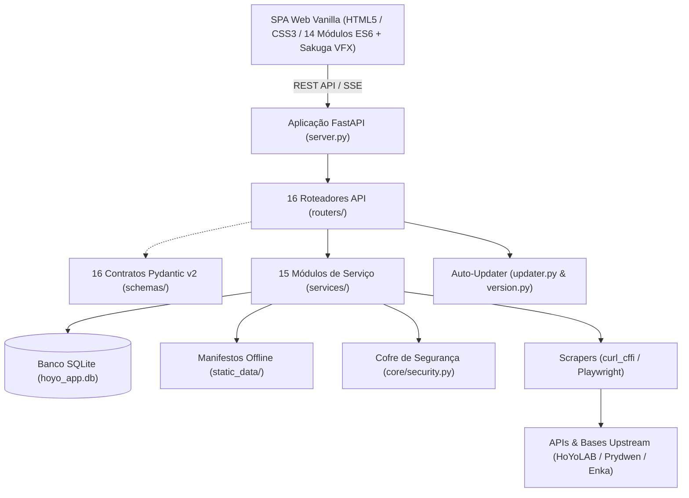

# Cabeça de Droid

<p align="center">
  <b>Idioma / Language:</b> <a href="README.md">🇧🇷 Português (Brasil)</a> | <a href="README.en.md">🇺🇸 English</a>
</p>

[](https://www.python.org/)
[](https://fastapi.tiangolo.com/)
[-ff477e.svg)](static/vendor/sakuga-vfx/)
[](LICENSE)
[](tests/)
[](SECURITY.md)

O **Cabeça de Droid** é uma suíte local de análise de metagame e gerenciamento multijogos para **Honkai: Star Rail**, **Genshin Impact** e **Zenless Zone Zero**. Combina ingestão automatizada de dados do meta, avaliação determinística de Valor de Rolagem (RV) de equipamentos, projeção probabilística de gacha via simulação de Monte Carlo, interface Web **Sakuga VFX** 100% offline e executável standalone para Windows com **Auto-Updater integrado via GitHub Releases**.

> [!NOTE]
> **Origem do Nome:** "Cabeça de Droid" faz referência à lore de *Honkai: Star Rail* — o título concedido por Herta ao **Aeon Nous** (o Aeon da Erudição), um supercomputador astronômico elevado à divindade.

---

## Como Baixar e Usar (Windows Standalone — Sem precisar instalar Python)

Se você deseja apenas usar o **Cabeça de Droid** no Windows sem precisar instalar Python, Git ou qualquer dependência manualmente:

1. Acesse a aba oficial de **[Releases no GitHub](https://github.com/Lacas0010/Cabeca_de_Droid/releases)**.
2. Na versão mais recente, baixe o arquivo **`Cabeca_de_Droid-Windows-x64.zip`**.
3. Extraia todo o conteúdo do arquivo `.zip` para uma pasta de sua preferência (por exemplo, `C:\Jogos\Cabeca_de_Droid`).
4. Dê um duplo clique em **`Cabeca_de_Droid.exe`**.
   - O aplicativo iniciará localmente com ícone na bandeja do sistema (System Tray) e abrirá a interface automaticamente no seu navegador padrão em `http://127.0.0.1:8000`.
   - Seus dados (banco SQLite, credenciais criptografadas, cache e logs) são preservados com segurança em `%APPDATA%\Cabeca_de_Droid`.
   - **Auto-Shutdown ao Fechar o Navegador:** Na versão empacotada (`.exe`), ao fechar todas as abas do Cabeça de Droid no navegador, o servidor encerra automaticamente via monitoramento de heartbeat + `sendBeacon` (em servidores Linux/VM com `--no-browser`, o processo permanece contínuo).
   - **Auto-Updater Integrado:** Ao abrir a aplicação (ou manualmente pelo botão **Atualizar** no rodapé da barra lateral), o aplicativo consulta o GitHub Releases sem travar o início, exibe release notes no modal Sakuga, baixa o novo `.zip` com barra de progresso em tempo real, verifica integridade ZipSlip, aplica os arquivos com segurança via `.bat` desanexado preservando banco/cofre/`.env` e reinicia automaticamente.
   - *(Opcional)* Para customizar `HOST`, `PORT` ou `ALLOW_LAN`, renomeie `.env.example` para `.env` na mesma pasta do executável.

> [!IMPORTANT]
> **Aviso sobre o Windows SmartScreen (Falso Positivo Comum):**  
> Como o executável é distribuído de forma independente (sem certificado pago de assinatura de código da Microsoft), o Windows Defender SmartScreen pode exibir a tela *"O Windows protegeu o computador"*.  
> Para abrir normalmente, clique em **"Mais informações"** e depois em **"Executar assim mesmo"**.

*(Para desenvolvedores que desejam contribuir ou rodar via código-fonte com Python/Git, consulte as seções [4](#4-pré-requisitos-e-instalação-rápida) e [5](#5-implantação-autohospedada-self-hosted) abaixo.)*

---

## 1. Módulos Principais & Funcionalidades

### 1.1 Ingestão Multijogos de Dados do Metagame
- **Extração Automatizada Upstream:** Utiliza `curl_cffi` com personificação de fingerprints TLS/JA3 de navegadores para contornar bloqueios 403 de CDNs, coletando guias de personagens, tier lists de equipamentos e métricas de rotação de bases consolidadas (Prydwen, Enka Network, HoYoLAB).
- **Raspagem Dinâmica de Banners:** Analisa em tempo real banners ativos de personagens e armas/cones/motores (*Invocação do Epítome*, *Fixação Brilhante*, *Sonata Dissonante*) salvando registros normalizados em `static_data/current_banners.json`.
- **Cache Determinístico Offline:** Opera autonomamente a partir dos manifestos JSON locais caso a conexão externa esteja indisponível.

### 1.2 Motor Determinístico de Valor de Rolagem (RV) de Equipamentos
- **Avaliação Multijogos:**
  - *Honkai: Star Rail:* Relíquias e Ornamentos Planos avaliados contra limites canônicos 5★.
  - *Genshin Impact:* Artefatos (Flor, Pluma, Areia, Cálice, Tiara) ponderados pelas escalas do personagem (ATQ, Vida, DEF, Recarga, Proficiência, Críticos).
  - *Zenless Zone Zero:* Discos de Drive (Espaços 1 a 6) considerando atributo principal, Proficiência de Anomalia e Críticos.
- **Ponderação por Função de Combate:** Pesos determinísticos ($1.00$ a $0.40$) derivados dos benchmarks da comunidade.
- **Tolerância de Atributo Principal (Primary Stat Forgiveness):** Concede $+40\%$ base para atributo principal recomendado, $+24\%$ para opções secundárias viáveis e $0\%$ para incompatíveis.
- **Fallback para Atributos Planos (Flat):** ATQ Plano, Vida Plana e DEF Plana recebem $50\%$ do peso do respectivo atributo percentual quando priorizado.

### 1.3 Simulador de Gacha, Forecast & Rastreador de Histórico
- **Modelagem Monte Carlo (10.000 Iterações):** Simula curvas exatas de probabilidade, média de invocações e intervalos de confiança para personagens (C0–C6 / E0–E6 / M0–M6) e armas/cones/motores (R1–R5).
- **Mecânicas Oficiais Fidelizadas:** Curvas de Soft Pity (tiro 74 para personagens, 63 para armas no Genshin e 65 para cones em HSR), taxas base, garantia de 50/50 e Caminho Divino / Pontos de Destino.
- **Metas de Banners & Contagem Regressiva:** Persistência no SQLite (`gacha_forecast_goals`) com cronômetro em tempo real sincronizado aos horários oficiais de abertura de fase.
- **Rastreador UIGF / SRGF:** Importação e exportação padronizada de histórico de saltos, orações e sinais com cálculo exato de pity e sorte histórica.

### 1.4 Planejador de Cultivo Diário (Ordem de Serviço)
- **Mapeamento de Rotação de Domínios:** Mapeia livros de talentos, ascensão de armas e rastros de acordo com o dia do servidor.
- **Alocação Priorizada por Roster:** Gera ordem de serviço diária priorizando gasto de resina, poder de desbravamento e bateria, com envio direto para Discord Webhook e Telegram.

### 1.5 Filtro de Descarte (Trash Finder) & Conselheiro de Síntese
- **Identificação de Peças Lixo:** Audita inventário contra os requisitos de todo o elenco indexado para indicar reciclagem segura.
- **Conselheiro de Síntese Personalizada:** Recomenda uso de *Resina Automodeladora* (HSR), *Elixir Santificador* (Genshin) ou *Sintetizador* (ZZZ) nos espaços mais fracos dos times ativos.

### 1.6 Índice de Eficiência de Rolagens & Cards HD 2x
- **Índice de Sorte:** Mede a qualidade global das rolagens 5★ equipadas e identifica automaticamente o **God Roll** e o **Cursed Roll** da conta.
- **Exportação 2x HD em Canvas:** Renderiza cards de personagens e cards de times (3 ou 4 vagas) em PNG 2400 × 1350 px com cópia instantânea para a área de transferência.

### 1.7 Endgame, Team Matcher & Eidolons Afinidades (HSR)
- **Auditoria de Desafios:** Monitora *Caos da Memória (MoC)*, *Ficção Pura (PF)*, *Sombra Apocalíptica (AS)*, *Espiral do Abismo*, *Teatro Imaginário*, *Defesa Shiyu* e *Assalto Mortal*.
- **Eidolons Adicionais (Affinitive / `ex_ranks_json`) & Variantes:** Suporte dedicado a variantes/Desbravadores no HSR e nós extras de Eidolon sem colisão de nomes/IDs.
- **Correspondência de Times:** Compara composições do meta com os personagens no SQLite e sugere substituições táticas viáveis.

### 1.8 Linha do Tempo, Códigos Promocionais & Fallback no Auto-Login
- **Snapshots de Evolução:** Registra snapshots periódicos ou manuais e compara a evolução da conta ao longo do tempo.
- **Resgate Autônomo de Códigos (3h):** Varre novos códigos e realiza o resgate automático com notificações desktop, Discord e Telegram.
- **Login Automatizado Resiliente:** Captura cookies do HoYoLAB via Playwright utilizando Chromium embutido ou fallback automático para Google Chrome / Microsoft Edge instalados no sistema operacional.

### 1.9 Cofre Criptográfico de Credenciais (Zero-Exposure)
- **Proteção Local de Tokens:** Protege `ltuid_v2`, `ltoken_v2` e `cookie_token_v2` com Windows DPAPI (`CryptProtectData`) ou AES-256-GCM / HMAC no Linux.
- **Blindagem de Privacidade:** Mascaramento (`mask_token`) em respostas HTTP, sanitização regex nos logs, vinculação loopback padrão (`127.0.0.1`) e bloqueio opcional por PIN (PBKDF2-HMAC-SHA256).

### 1.10 Interface Sakuga VFX Offline-First & Workspace Horizontal
- **11 Web Components Sakuga VFX Locais (`static/vendor/sakuga-vfx/`):** `<sakuga-button>`, `<sakuga-toggle>`, `<sakuga-slider>`, `<sakuga-checkbox>`, `<sakuga-radio>`, `<sakuga-input>`, `<sakuga-tabs>`, `<sakuga-progress>`, `<sakuga-rating>`, `<sakuga-toast>` e `<sakuga-tooltip>` carregados 100% offline.
- **Bilinguismo Integral (PT-BR / EN-US):** Alternância imediata em toda a UI, atributos, endgame e farm diário (`i18n.js` + `services/translation_service.py`).
- **Roster Modo Grade / Lista Enriquecida (Opção C):** Ordenações inteligentes (Poder, RV, Nível, A–Z/Z–A), filtros de auditoria e específicos por jogo, raridades canônicas e busca com debounce + `AbortController`.
- **Layout Desktop Otimizado & Motor de Performance:** Cards horizontais na aba Configurações em telas desktop (`> 768px`), GZip, cache TTL em RAM (60s), consultas em lote sem N+1, proxy WebP LANCZOS (`/api/proxy_image`) e fontes WOFF2 auto-hospedadas (`Inter` e `Outfit`).

### 1.11 Auto-Updater Integrado via GitHub Releases
- **Versão Única (`version.py`):** Injetada automaticamente pelo workflow do GitHub Actions a partir da tag da release (`v*.*.*`).
- **Atualização Segura no Windows (`updater.py` & `routers/updater.py`):** Checagem assíncrona em 5s, modal Sakuga com notas da versão e `<sakuga-progress>`, verificação de domínio oficial + proteção contra ZipSlip, script `.bat` desanexado que aguarda o encerramento do PID, preserva banco SQLite, cofre criptográfico e `.env`, e reinicia o executável automaticamente.

---

## 2. Metodologia de Cálculo de Valor de Rolagem (RV)

### 2.1 Formulação Matemática

$$RV_i = \frac{\text{Valor Observado do Substatus}_i}{\text{Valor Máximo de Rolagem 5★}_i}$$

$$\text{Pontuação de Substatus da Peça} = \sum_{i=1}^{n} \left( RV_i \times W_i \right)$$

Pesos $W_i \in [0.0, 1.0]$ conforme prioridade da build:
- **Substatus Prioridade 1:** $W = 1.00$
- **Substatus Prioridade 2:** $W = 0.85$
- **Substatus Prioridade 3:** $W = 0.70$
- **Substatus Prioridade 4:** $W = 0.55$
- **Substatus Prioridade 5:** $W = 0.40$
- **Atributos Secundários / Reserva:** $W = 0.30$
- **Fallback Plano (Flat):** ATQ/Vida/DEF planos recebem $50\%$ do peso do percentual equivalente quando priorizado.

### 2.2 Tolerância de Atributo Principal (Primary Stat Forgiveness)
- **Atributo Principal Recomendado:** $+40\%$ de crédito base.
- **Atributo Principal Secundário / Viável:** $+24\%$ de crédito base.
- **Atributo Principal Inviável:** $0\%$ de crédito base.
- **Espaços com Atributo Fixo:** Crédito base fixado em $30\%$, com $70\%$ distribuídos nos substatus.

### 2.3 Pontuação Geral da Build

$$\text{Pontuação Geral da Build} = \frac{\sum_{k=1}^{N_{\text{equipados}}} \text{Pontuação da Peça}_k}{N_{\text{espaços totais}}}$$

($N_{\text{espaços totais}} = 6$ para HSR e ZZZ; $5$ para Genshin Impact).

### 2.4 Escala de Classificação

| Classificação | Intervalo de Pontuação | Critério Técnico |
| :---: | :---: | :--- |
| **SSS** | $\ge 90.0\%$ | Rolagens ótimas em todos os atributos prioritários; máxima eficiência |
| **SS** | $75.0\% - 89.9\%$ | Alto investimento; desperdício mínimo de atributos |
| **S** | $60.0\% - 74.9\%$ | Padrão competitivo pronto para modos de fim de jogo |
| **A** | $45.0\% - 59.9\%$ | Build funcional; distribuição aceitável de substatus |
| **B** | $30.0\% - 44.9\%$ | Equipamento de transição; ausência de rolagens essenciais |
| **C** | $15.0\% - 29.9\%$ | Baixa eficiência; atributos principais ou rolagens incorretas |
| **D** | $< 15.0\%$ | Inviável; indicação para substituição imediata |

### 2.5 Valores Base Canônicos de Rolagens 5★

#### Honkai: Star Rail (Relíquias 5★)

| Substatus | Rolagem Mínima | Rolagem Média | Rolagem Máxima (1.0 RV) |
| :--- | :---: | :---: | :---: |
| **Taxa Crítica** | 2.59% | 2.91% | 3.24% |
| **Dano Crítico** | 5.18% | 5.83% | 6.48% |
| **VEL** | 2.00 | 2.30 | 2.60 |
| **Efeito de Quebra** | 5.18% | 5.83% | 6.48% |
| **Taxa de Acerto de Efeito (EHR)** | 3.45% | 3.88% | 4.32% |
| **Resistência a Efeito (RES)** | 3.45% | 3.88% | 4.32% |
| **ATK% / HP%** | 3.45% | 3.88% | 4.32% |
| **DEF%** | 4.32% | 4.86% | 5.40% |
| **ATK Plano / DEF Plano** | 17.00 | 19.15 | 21.30 |
| **HP Plano** | 33.80 | 38.05 | 42.30 |

#### Genshin Impact (Artefatos 5★)

| Substatus | Rolagem Mínima | Rolagem Média | Rolagem Máxima (1.0 RV) |
| :--- | :---: | :---: | :---: |
| **Taxa Crítica** | 2.72% | 3.30% | 3.89% |
| **Dano Crítico** | 5.44% | 6.61% | 7.77% |
| **Recarga de Energia** | 4.53% | 5.51% | 6.48% |
| **Proficiência Elemental** | 16.32 | 19.82 | 23.31 |
| **ATK% / HP%** | 4.08% | 4.96% | 5.83% |
| **DEF%** | 5.10% | 6.20% | 7.29% |
| **ATK Plano** | 13.62 | 16.54 | 19.45 |
| **HP Plano** | 209.13 | 253.94 | 298.75 |
| **DEF Plano** | 16.20 | 19.68 | 23.15 |

#### Zenless Zone Zero (Discos de Drive Rank S)

| Substatus | Rolagem Mínima | Rolagem Média | Rolagem Máxima (1.0 RV) |
| :--- | :---: | :---: | :---: |
| **Taxa Crítica** | 2.40% | 2.70% | 3.00% |
| **Dano Crítico** | 4.80% | 5.40% | 6.00% |
| **Taxa de Penetração (PEN)** | 9.00 | 10.50 | 12.00 |
| **Proficiência de Anomalia** | 9.00 | 10.50 | 12.00 |
| **ATK% / HP%** | 2.40% | 2.70% | 3.00% |
| **DEF%** | 3.84% | 4.32% | 4.80% |
| **ATK Plano / DEF Plano** | 15.00 | 17.50 | 20.00 |
| **HP Plano** | 90.00 | 102.50 | 115.00 |

---

## 3. Arquitetura e Tecnologias



### Componentes da Stack
- **Backend:** Python 3.10+, FastAPI, Pydantic v2, Uvicorn, `httpx`, `packaging`.
- **Raspagem & Ingestão:** `curl_cffi`, BeautifulSoup4, `genshin`, `rapidfuzz`, Playwright (Chromium + fallback Chrome/Edge).
- **Persistência:** SQLite (`hoyo_app.db` — 15 tabelas descritas em [docs/db_schema.md](docs/db_schema.md)) + manifestos JSON em `static_data/`.
- **Empacotamento Windows:** `pyinstaller`, `pystray`, `Pillow`, `core/paths.py` e pipeline GitHub Actions em [.github/workflows/release.yml](.github/workflows/release.yml).
- **Segurança:** Windows DPAPI (`ctypes.windll.crypt32`) e AES-256-GCM / HMAC em sistemas POSIX.
- **Frontend:** HTML5, CSS3 (`:root` + `--sk-*`), 14 módulos ES6+ e 11 Web Components **Sakuga VFX** locais.

---

## 4. Pré-requisitos e Instalação Rápida

### Requisitos de Sistema
- Python 3.10 ou superior
- Git
- Chromium (instalado via Playwright)

### Procedimento de Instalação

```bash
# 1. Clonar repositório
git clone https://github.com/Lacas0010/Cabeca_de_Droid.git
cd Cabeca_de_Droid

# 2. Configurar ambiente virtual
python -m venv .venv

# Windows PowerShell:
.\.venv\Scripts\Activate.ps1
# Linux / macOS:
source .venv/bin/activate

# 3. Instalar dependências
pip install -r requirements.txt
playwright install chromium

# 4. Iniciar o serviço web
python main.py
```

URL de acesso local: `http://127.0.0.1:8000`

### Gerar o Build Standalone Windows Localmente
```bash
python build.py
```
Gera o executável em `dist/` e o pacote limpo `dist/Cabeca_de_Droid-Windows-x64.zip` após validar a integridade dos assets Sakuga VFX.

---

## 5. Implantação Autohospedada (Self-Hosted)

### 5.1 Serviço Systemd (Linux)

Crie `/etc/systemd/system/cabeca-de-droid.service` (modelo em [scripts/cabeca-de-droid.service](scripts/cabeca-de-droid.service)):

```ini
[Unit]
Description=Serviço de Metagame Cabeca de Droid
After=network.target

[Service]
Type=simple
User=ubuntu
WorkingDirectory=/home/ubuntu/Cabeca_de_Droid
ExecStart=/home/ubuntu/Cabeca_de_Droid/.venv/bin/python main.py --host 0.0.0.0 --port 8000 --no-browser
Restart=always
RestartSec=5
Environment=PYTHONUNBUFFERED=1

[Install]
WantedBy=multi-user.target
```

Habilitar e iniciar o serviço:

```bash
sudo systemctl daemon-reload
sudo systemctl enable cabeca-de-droid
sudo systemctl start cabeca-de-droid
```

### 5.2 Implantação em Contêiner (OCI / Docker)

```dockerfile
FROM python:3.11-slim

WORKDIR /app

RUN apt-get update && apt-get install -y --no-install-recommends \
    curl git && \
    rm -rf /var/lib/apt/lists/*

COPY requirements.txt .
RUN pip install --no-cache-dir -r requirements.txt && \
    playwright install-deps chromium && \
    playwright install chromium

COPY . .

EXPOSE 8000

CMD ["python", "main.py", "--host", "0.0.0.0", "--port", "8000", "--no-browser"]
```

Compilação e execução:

```bash
docker build -t cabeca-de-droid .
docker run -d -p 8000:8000 -v $(pwd)/hoyo_app.db:/app/hoyo_app.db cabeca-de-droid
```

---

## 6. Configuração e Parâmetros de Linha de Comando (CLI)

| Parâmetro | Tipo | Padrão | Descrição |
| :--- | :---: | :---: | :--- |
| `--host` | `str` | `127.0.0.1` | Interface de rede para vinculação (`0.0.0.0` para rede local). |
| `--port` | `int` | `8000` | Porta TCP de escuta. |
| `--lan` | `flag` | `False` | Atalho para vincular a `--host 0.0.0.0`. |
| `--no-browser` | `flag` | `False` | Desativa a abertura automática do navegador na inicialização. |
| `--no-tray` | `flag` | `False` | Desativa o ícone na bandeja do sistema (Windows Taskbar Tray). |

---

## 7. Referência da API REST

| Método | Endpoint | Descrição |
| :--- | :--- | :--- |
| `GET` | `/api/overview` | Metadados consolidados de contas, energia e elenco ativo nos 3 jogos. |
| `GET` | `/api/roster/{game_id}` | Elenco completo com Valores de Rolagem calculados e notas de equipamento. |
| `GET` | `/api/build/{game_id}/{char_name}` | Detalhamento de equipamentos, habilidades, rastros/talentos e progressão. |
| `GET` | `/api/compare/{game_id}/{char_name}` | Auditoria determinística de build contra metas da comunidade. |
| `POST` | `/api/sync/{game_id}` | Dispara sincronização em segundo plano do elenco e manifestos de guias. |
| `POST` | `/api/sync/all` | Dispara sincronização global unificada entre os jogos configurados. |
| `GET` | `/api/endgame/{game_id}` | Fases concluídas, estrelas e ciclos em modos de fim de jogo. |
| `GET` | `/api/endgame/team-match/{game_id}` | Cálculo de compatibilidade de times e substitutos recomendados. |
| `GET` | `/api/strategy/account-gaps/{game_id}` | Diagnóstico determinístico de cobertura elemental e de funções. |
| `GET` | `/api/gacha/current-banners` | Banners ativos extraídos dinamicamente do Prydwen. |
| `POST` | `/api/gacha/current-banners/sync` | Força a raspagem em tempo real dos banners ativos. |
| `GET` | `/api/gacha/defaults/{game_id}` | Parâmetros padrão do simulador (pity, garantido, banner atual). |
| `POST` | `/api/gacha/calculate` | Simulação Monte Carlo (10.000 iterações). |
| `POST` | `/api/gacha/forecast/calculate` | Projeção de acúmulo de recursos e metas de banners futuros. |
| `GET` / `POST` | `/api/gacha/goals` | Consulta e persistência de metas salvas com cronômetro. |
| `GET` | `/api/gacha/tracker/{game_id}` | Histórico de saltos/orações/sinais com distribuição e pity. |
| `POST` | `/api/gacha/tracker/import` | Importação nos padrões UIGF v2.4 e SRGF. |
| `GET` | `/api/farming/today` | Domínios abertos hoje e ordem diária priorizada. |
| `GET` | `/api/trash/{game_id}` | Filtro de descarte para peças com baixo RV ou substatus conflitantes. |
| `GET` | `/api/relics/craft-recommendations/{game_id}` | Sugestões de síntese para Resina, Elixir e Discos de Drive. |
| `GET` | `/api/luck/{game_id}` | Eficiência de rolagem da conta com God Roll e Cursed Roll. |
| `GET` | `/api/notes` | Contadores de resina/energia, missões diárias e expedições. |
| `POST` | `/api/checkin/run` | Executa check-in diário no HoYoLAB. |
| `GET` | `/api/briefing/today` | Sumário executivo matinal consolidado dos 3 jogos. |
| `GET` | `/api/history/{game_id}` | Linha do tempo paginada de snapshots (`?limit=50&offset=0`). |
| `POST` | `/api/history/{game_id}/snapshot` | Registra manualmente um snapshot de evolução da conta. |
| `GET` | `/api/codes` | Códigos promocionais ativos e status do auto-redeem. |
| `GET` | `/api/codes/history/{game_id}` | Histórico paginado de códigos resgatados (`?limit=50&offset=0`). |
| `GET` | `/api/proxy_image` | Proxy de imagens com redimensionamento LANCZOS e conversão WebP. |
| `GET` / `POST` | `/api/static-data/status` & `/sync` | Estado e sincronização dos manifestos JSON offline. |
| `GET` | `/api/updater/check` | Checagem não bloqueante da última release semântica e asset `.zip` no GitHub. |
| `POST` | `/api/updater/start` | Inicia download e troca segura em background (aviso amigável em dev). |
| `GET` | `/api/updater/status` | Consulta progresso (`0.0`–`1.0`) e estágio atual da atualização. |
| `POST` | `/api/system/heartbeat` & `/disconnect` | Monitoramento de ciclo de vida das abas para auto-shutdown no `.exe`. |

---

## 8. Bibliotecas Frontend Empacotadas

Para garantir funcionamento **100% offline** no executável Windows, as bibliotecas visuais residem localmente em `static/vendor/`:
- **[Sakuga VFX](https://github.com/finktheartist/sakuga-vfx)** — Web Components animados nativos.
- **FontAwesome**, **Marked.js**, **html2canvas** e fontes locais WOFF2 (**Inter** e **Outfit**).

---

## 9. Licença e Contribuição

- **Licença:** Distribuído sob a [Licença MIT](LICENSE).
- **Contribuição:** Solicitações de pull (PR) para `main` devem passar integralmente na suíte offline de testes (`python -m unittest discover tests` — atualmente **231 testes**). Configurações opcionais de `ruff` e `mypy` estão definidas em [pyproject.toml](pyproject.toml). Consulte [CONTRIBUTING.md](CONTRIBUTING.md).
- **Segurança:** Para especificação do cofre criptográfico, verificação do updater e reporte de vulnerabilidades, consulte [SECURITY.md](SECURITY.md).
