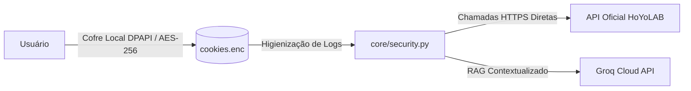
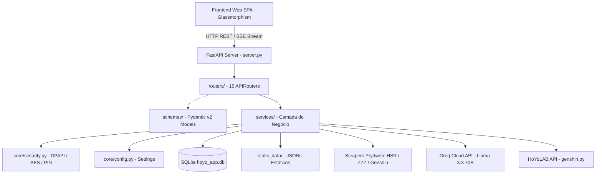

# 🤖 Cabeça de Droid (HoYo AI Assistant & Local RAG v5.3+)

<p align="center">
  <b>Language / Idioma:</b> <a href="README.md">🇧🇷 Português</a> | <a href="README.en.md">🇺🇸 English</a>
</p>

[](https://www.python.org/)
[](https://fastapi.tiangolo.com/)
[](LICENSE)
[](tests/)
[](SECURITY.md)

Suíte local inteligente com interface gráfica **Web Glassmorphism** (HTML5/CSS3/ES6+ Modular) e backend modular em Python (**FastAPI + Clean Architecture + SQLite + Playwright + Groq Cloud RAG + Windows DPAPI Security Vault + Zero-Maintenance Datamines**).

> [!NOTE]
> **Sobre o nome:** "Cabeça de Droid" é uma referência a *Honkai: Star Rail* — o apelido carinhoso que Herta dá ao **Aeon Nous** (o Aeon da Erudição), um supercomputador astral que ascendeu à divindade.

---

## ⚡ Início Rápido (Quick Start em 3 Passos)

```bash
# 1. Clonar e entrar no repositório
git clone https://github.com/Lacas0010/Cabeca_de_Droid.git
cd Cabeca_de_Droid

# 2. Criar ambiente virtual e instalar dependências
python -m venv .venv
.\.venv\Scripts\Activate.ps1   # Linux/macOS: source .venv/bin/activate
pip install -r requirements.txt
playwright install chromium

# 3. Executar o aplicativo
python main.py
```

* **Acesso Local (PC):** `http://127.0.0.1:8000`
* **Acesso no Celular/Tablet (Rede Wi-Fi):** `http://<IP_DO_SEU_PC>:8000` *(habilitável em Configurações)*
* **Rodar Testes:** `python -m unittest discover tests` *(150 testes unitários inclusos)*

---

## 🌟 Recursos Principais

| Módulo                                         | Ícone | O que faz?                                                                                                                                                                                                                                 |
| :---------------------------------------------- | :----: | :----------------------------------------------------------------------------------------------------------------------------------------------------------------------------------------------------------------------------------------- |
| **1. Ícone na Bandeja (System Tray)**    |   🛸   | Execução minimizada em segundo plano no Windows 10/11 com menu de contexto (abrir dashboard, sincronizar roster, alternar notificações e encerrar servidor).                                                                           |
| **2. Endgame Team Matcher**               |  ⚔️  | Cruza as melhores composições do meta atual (MoC, Ficção Pura, Sombra, Abismo, Shiyu) com seu Roster real no SQLite, calcula % de compatibilidade e recomenda substitutos funcionais disponíveis na sua conta para membros faltantes. |
| **3. Rastreador Oficial de Pity & Tiros** |   📜   | Importação e exportação de logs reais no padrão universal UIGF v2.4/SRGF, cálculo exato de Pity Atual, garantia 100% vs 50/50 e estatísticas de sorte.                                                                              |
| **4. Sandbox de Troca de Peças**         |   🧪   | Simulação de substituição de relíquias ("E se eu trocasse a peça?") prevendo variações de score, Roll Value, deltas de atributos e novos breakpoints.                                                                              |
| **5. Multi-UID Switcher**                 |   👥   | Alternância instantânea entre múltiplas contas salvas no SQLite para o mesmo jogo, com isolamento de roster e peças.                                                                                                                   |
| **6. Monitor de Energia**                 |   🔋   | Monitor de Resina, Poder de Desbravamento e Bateria com anéis SVG e contagem regressiva.                                                                                                                                                  |
| **7. Auto Check-in 6h**                   |   🎁   | Resgate automático das recompensas diárias da HoYoLAB a cada 6h gravado no SQLite.                                                                                                                                                       |
| **8. Auto-Sync 04:00**                    |   ⏰   | Agendamento diário automático para atualizar Roster e guias com detecção de diffs.                                                                                                                                                     |
| **9. Interface Glassmorphism & ES6**      |   📁   | Painel escuro moderno, temas por jogo, gaveta off-canvas deslizante no mobile e arquitetura modular ES6 desacoplada em 12 submódulos.                                                                                                      |
| **10. Acesso LAN / Wi-Fi**                |   📱   | Binding `0.0.0.0:8000` sob demanda para uso no smartphone ou tablet na rede local.                                                                                                                                                       |
| **11. Galeria com Ícones Oficiais**      |   🎨   | Filtros por Elemento (incluindo *Lumiflux* de ZZZ) e Raridade com avatares em cache local.                                                                                                                                               |
| **12. Proxy Anti-CORS**                   |  🖼️  | Endpoint `/api/proxy_image` para carregamento seguro de imagens em Canvas 2D.                                                                                                                                                            |
| **13. Tracker de Endgame**                |  ⚔️  | Histórico de Abismo Espiral, Teatro Imaginário, MoC, Pura Ficção, Sombra e Defesa Shiyu.                                                                                                                                               |
| **14. Inspetor de Builds Centralizado**   |  🗡️  | Janela modal centralizada em 2 colunas, avaliação por Roll Value (RV), Main Stat Forgiveness e notas de **SSS** a **D**.                                                                                                     |
| **15. Eidolons & Shards (HSR)**           |   💎   | Fragmentos de arte in-game nos nós de Eidolon e suporte a splash arts de skins (Sparkle, Robin).                                                                                                                                          |
| **16. Mindscapes & Habilidades (ZZZ)**    |   ⚡   | Ícones de Cinema Mental 01-06 em neon e categorias oficiais de combate (Básico, Especial, Esquiva, etc.).                                                                                                                                |
| **17. Tooltips & Descrições Ricas**     |   ✨   | Hover action com descrições detalhadas e completas de Talentos, Rastros e Habilidades sem tags HTML.                                                                                                                                     |
| **18. Exportação em Imagem HD**         |   📷   | Renderização em **4K (2400 × 1350 px)** de Cards de Build, Tier List e Diffs de Evolução.                                                                                                                                       |
| **19. Breakpoints & Speed Tuning**        |  ⚖️  | Action Value (10000/SPD), metas de 134/160.1 SPD no Ciclo 0 de MoC/PF, sincronia -1 SPD (Bronya/Sunday), checagem Favonius e proporção áurea 1:2.                                                                                       |
| **20. Calculadora de Ascensão**          |   🧮   | Cálculo exato de Mora, XP e materiais com caps reais (**Genshin 90**, **HSR 80**, **ZZZ 60**).                                                                                                                          |
| **21. Otimizador IA Groq**                |   🧠   | Consultoria instantânea com Llama 3.3 70B gerando 3 melhorias prioritárias para a build.                                                                                                                                                 |
| **22. Diagnóstico de Lacunas**           |   🔥   | Mapeamento de fraquezas da conta (DPS/Sustento/Elemento) e modo Roast sarcástico.                                                                                                                                                         |
| **23. Índice de Sorte (Luck Score)**     |   🍀   | Medidor de RNG da conta (SSS+ a F), destacando a peça **God Roll #1** e a **Cursed Roll**.                                                                                                                                    |
| **24. Gacha Forecast & Metas em Tempo Real** |   🎲   | Simulação Monte Carlo, persistência de metas de banners no SQLite com **cronômetro regressivo ao vivo** segundo a segundo e horários oficiais HoYoverse (**1ª Fase às 23:30**; **2ª Fase Genshin 20h, HSR/ZZZ 14h**). |
| **25. Central de Farm & OS Diária**      |   🌾   | Domínios abertos hoje e Ordem de Serviço Diária com alocação inteligente de resina.                                                                                                                                                   |
| **26. Trash Finder & Peças Coringa**     |  🗑️  | Varredura de relíquias sem utilidade, proteção absoluta de peças Coringa/Off-Piece (Duplo Crítico/CV) e conselheiro de síntese.                                                                                                      |
| **27. Chat IA & RAG Conversacional**     |   💬   | Chat RAG conversacional com histórico persistente no SQLite por jogo e streaming SSE com Groq Cloud (Llama 3.3 70B).                                                                                                                      |
| **28. Montador de Card de Time HD**      |   👥   | Construtor visual de composições de 4 slots (ou 3 slots no ZZZ), badges dinâmicas, exportação PNG 2x sem distorção e cópia direta para o Clipboard (`Discord`/`WhatsApp`).                                                              |

---

## 🍪 Segurança de Dados & Cookies HoYoLAB

O aplicativo utiliza cookies de sessão oficiais (`ltuid_v2`, `ltoken_v2`, `cookie_token_v2`) para interagir com a HoYoverse sem exigir login por senha.



### Resumo de Privacidade

* **Senhas e `stoken`:** **NUNCA** solicitados ou armazenados.
* **Criptografia em Repouso:** Arquivos `.enc` criptografados nativamente no Windows via **DPAPI** e no Linux via **AES-256/HMAC**.
* **Zero-Exposure no Frontend:** A interface gráfica exibe apenas tokens mascarados (ex: `ltuid_v2=282***47; ltoken_v2=v2_CA***JkXB`).
* **Higienização de Logs:** Filtro regex automático censura segredos antes de qualquer saída no terminal ou SSE.

Para detalhes completos de governança e modelagem de ameaças, leia o [SECURITY.md](SECURITY.md).

---

## ⚙️ Arquitetura do Sistema (Clean Architecture)



---

## 📂 Estrutura Modular do Projeto

```
hoyo-projetos/
├── core/                    # Infraestrutura, configurações e segurança criptográfica
├── schemas/                 # Contratos tipados Pydantic v2 (validação de entrada e saída)
├── services/                # Regras de negócio desacopladas (Sync, Checkin, Gacha, Roster, Codes)
├── routers/                 # 15 Controladores REST FastAPI (APIRouter)
├── static_data/             # Catálogos de personagens, domínios e regras em JSON puro
├── static/                  # Frontend Web SPA (HTML5, Vanilla CSS, JS ES6 Modular)
│   ├── js/
│   │   ├── app.js           # Ponto de entrada SPA e orquestrador
│   │   └── modules/         # 12 submódulos desacoplados (api_client, chat_rag, gacha_sim, etc.)
│   ├── style.css            # Estilos Glassmorphism e responsividade mobile
│   └── index.html           # SPA principal
├── assets/                  # Ícones oficiais de elementos e avatares em cache local
├── scrapers/                # Raspadores de metagame e guias do Prydwen (HSR, Genshin, ZZZ)
├── scripts/                 # Scripts utilitários e serviços do sistema (systemd)
├── tests/                   # 150 testes unitários automatizados cobrindo todos os módulos
├── server.py                # Orquestrador FastAPI modular com ciclo de vida
└── main.py                  # Entrypoint de inicialização da aplicação
```

---

## 🧮 Motor de Pontuação Roll Value (RV) & Ponderação de Build

A nota de cada peça de relíquia/artefato/disco é calculada avaliando o Roll Value (RV) dos substatus contra os rolls máximos de peças 5★/S-Rank:

$$
RV_i = \frac{\text{Valor Real do Substatus}_i}{\text{Valor Máximo do Roll 5★}}
$$

$$
\text{Score da Peça} = \sum_{i} \left( RV_i \times \text{Peso}_i \right)
$$

$$
\text{Nota Geral da Build} = \frac{\sum_{k=1}^{\text{Peças Equipadas}} \text{Score da Peça}_k}{\text{Total de Slots do Jogo}}
$$

1. **Normalização Contextual de Slots (`normalize_slot_name`):** Converte posições numéricas do HoYoLAB (`1` a `5`/`6`) para as chaves exatas de cada jogo (ex: `flower`, `plume`, `sands`, `goblet`, `circlet` em Genshin; `head`, `hands`, `body`, `feet`, `planar_sphere`, `link_rope` em HSR; `slot_1` a `slot_6` em ZZZ), garantindo avaliação correta do Main Stat recomendado.
2. **Main Stat Forgiveness:** Se o atributo principal da peça for um dos recomendados no guia (ex: Copo de ATQ% ou Botas de VEL), a peça recebe 40% de crédito base do Main Stat.
3. **Flat Stat Fallback:** Substatus brutos (Ataque Flat, Vida Flat, Defesa Flat) recebem peso parcial automático (50% do peso da versão %) se a versão percentual for recomendada pelo guia.
4. **Benchmark Dinâmico por Substatus Prioritários:** O limite teórico de rolagens adapta-se dinamicamente à quantidade de substatus prioritários que sobraram pós-exclusão do Main Stat:
   - **1 prioritário restante:** 4.0 rolagens no 1º + 5.0 rolagens no pool de outros atributos (peso 0.30).
   - **2 prioritários restantes:** 4.0 rolagens no 1º + 3.0 no 2º + 2.0 rolagens no pool de outros atributos.
   - **3 prioritários restantes:** 5.0 rolagens no 1º + 2.0 no 2º + 1.0 no 3º + 1.0 rolagem no pool de outros atributos.
   - **4+ prioritários restantes:** Distribuição padrão de 9 rolagens `[6.0, 1.0, 1.0, 1.0]`.
5. **Ponderação Proporcional por Slots Totais:** O divisor da Nota Geral é fixo no total de slots do jogo ($6$ para HSR/ZZZ, $5$ para Genshin). Slots vazios/não equipados pontuam $0.0$, penalizando builds incompletas proporcionalmente.

---

## 📡 Endpoints Principais da API REST

| Método  | Endpoint                                             | Descrição                                                               |
| :------- | :--------------------------------------------------- | :------------------------------------------------------------------------ |
| `GET`  | `/api/overview`                                    | Estatísticas unificadas das contas (UID, Nível, Chars)                  |
| `GET`  | `/api/security/status`                             | Status do cofre DPAPI, autenticação por PIN e isolamento LAN            |
| `POST` | `/api/security/pin/verify`                         | Validação de PIN e emissão de sessão segura                           |
| `GET`  | `/api/roster/{game_id}`                            | Roster completo com builds, notas RV e relíquias                         |
| `GET`  | `/api/build/{game_id}/{char_name}`                 | Dados completos da build (armas, relíquias, status, habilidades e ranks) |
| `GET`  | `/api/compare/{game_id}/{char_name}`               | Comparador da build do jogador com a meta recomendada                     |
| `GET`  | `/api/optimize/{game_id}/{char_name}`              | Sugestões inteligentes de otimização de build geradas via IA           |
| `POST` | `/api/sync/{game_id}`                              | Inicia sincronização assíncrona de Roster e Metagame                   |
| `GET`  | `/api/notes`                                       | Monitor de energia/resina/bateria em tempo real                           |
| `POST` | `/api/checkin/run`                                 | Executa o check-in diário na HoYoLAB                                     |
| `POST` | `/api/gacha/forecast/calculate`                    | Simulação Monte Carlo e projeção de tiros para banners                |
| `GET`  | `/api/gacha/goals/{game_id}`                       | Recupera metas salvas com cronômetro ao vivo e horários oficiais         |
| `POST` | `/api/gacha/goals`                                 | Salva meta estratégica com data alvo e horários oficiais por fase       |
| `GET`  | `/api/gacha/defaults/{game_id}`                    | Pity atual, status de 50/50 e banners oficiais ativos com horário        |
| `GET`  | `/api/strategy/account-gaps/{game_id}`             | Diagnóstico de lacunas de arquétipos e cobertura elemental              |
| `GET`  | `/api/farm/order-of-day/{game_id}`                 | Ordem de Serviço Diária com alocação otimizada de resina              |
| `GET`  | `/api/relics/craft-recommendations/{game_id}`      | Recomendações de síntese com Resina Automodeladora                     |
| `GET`  | `/api/briefing/today`                              | Morning Briefing executivo diário                                        |
| `POST` | `/api/codes/redeem`                                | Resgate em lote de códigos promocionais ativos                           |
| `POST` | `/api/team/analyze`                                | Análise de sinergia de equipes de 4 slots via SSE Stream                 |
| `POST` | `/api/chat`                                        | Chat conversacional RAG com Groq Llama 3.3 70B (SSE)                      |
| `GET`  | `/api/static-data/status`                          | Status geral dos manifestos de dados estáticos e catálogos offline      |
| `GET`  | `/api/static-data/schedule/{game_id}`              | Calendário diário de materiais de farm e domínios abertos hoje         |
| `GET`  | `/api/static-data/character/{game_id}/{char_name}` | Perfil detalhado de materiais, chefes e ascensão do personagem           |
| `POST` | `/api/static-data/sync`                            | Sincronização sob demanda dos manifestos e datamines locais             |

---

## 📄 Governança, Licença e Contribuição

* **Licença:** Distribuído sob a licença [MIT](LICENSE).
* **Guia de Contribuição:** Para padrões de código, fluxo de PR e guia de testes, consulte o [CONTRIBUTING.md](CONTRIBUTING.md).
* **Histórico de Mudanças:** Consulte o [CHANGELOG.md](CHANGELOG.md) para a lista de novidades de cada versão.
* **Segurança:** Leia o [SECURITY.md](SECURITY.md) para detalhes de criptografia e reporte de vulnerabilidades.
