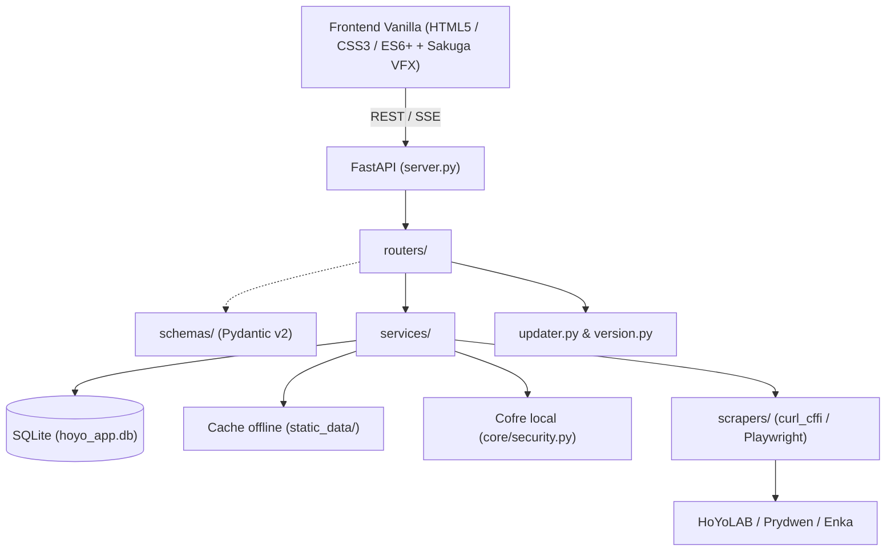

# Cabeça de Droid

<p align="center">
  <b>Idioma / Language:</b> <a href="README.md">🇧🇷 Português (Brasil)</a> | <a href="README.en.md">🇺🇸 English</a>
</p>

[](https://www.python.org/)
[](https://fastapi.tiangolo.com/)
[-ff477e.svg)](static/vendor/sakuga-vfx/)
[](LICENSE)
[](tests/)
[](SECURITY.md)

O **Cabeça de Droid** é um app local feito para analisar builds, acompanhar gacha e organizar o farm diário de **Honkai: Star Rail**, **Genshin Impact** e **Zenless Zone Zero**. Ele junta coleta automática de guias e tier lists, cálculo de Roll Value (RV) das peças, simulador de gacha (10 mil simulações), interface web **Sakuga VFX** 100% offline e executável para Windows com atualização automática via GitHub Releases.

> [!NOTE]
> **Origem do nome:** "Cabeça de Droid" faz referência à lore de *Honkai: Star Rail*: o apelido dado por Herta a **Nous**, o Aeon da Erudição.

---

## Como baixar e rodar no Windows (`.exe`)

Se você só quer usar o app no Windows sem configurar ambiente de desenvolvimento:

1. Baixe **`Cabeca_de_Droid-Windows-x64.zip`** na aba de **[Releases no GitHub](https://github.com/Lacas0010/Cabeca_de_Droid/releases)**.
2. Extraia o `.zip` em qualquer pasta (ex.: `C:\Jogos\Cabeca_de_Droid`).
3. Abra **`Cabeca_de_Droid.exe`**.
   - O app sobe em `http://127.0.0.1:8000`, cria um ícone na bandeja do Windows e abre no seu navegador.
   - Banco SQLite, cookies criptografados, cache e logs ficam salvos em `%APPDATA%\Cabeca_de_Droid`.
   - Ao fechar todas as abas do navegador no modo `.exe`, o servidor fecha sozinho. Quando sair versão nova no GitHub, o modal de atualização baixa o `.zip`, preserva seus dados locais e reinicia o executável.
   - *(Opcional)* Renomeie `.env.example` para `.env` na pasta do `.exe` para mudar `HOST`, `PORT` ou `ALLOW_LAN`.

> [!IMPORTANT]
> **Aviso do Windows SmartScreen:** Como o `.exe` não tem certificado pago da Microsoft, o Windows pode mostrar *"O Windows protegeu o computador"*. Clique em **"Mais informações"** e depois em **"Executar assim mesmo"**.

*(Para rodar direto pelo Python/Git ou subir em servidor Linux/Docker, veja as seções [4](#4-instalação-para-desenvolvedores) e [5](#5-hospedagem-própria-self-hosted).)*

---

## 1. O que o app faz

- **Coleta automática de guias e banners:** Busca guias, tier lists e builds recomendadas no Prydwen, Enka Network e HoYoLAB (usando `curl_cffi` para evitar bloqueios 403), além dos banners ativos (*Invocação do Epítome*, *Fixação Brilhante*, *Sonata Dissonante*) salvos em `static_data/current_banners.json`. Se você ficar sem internet, usa o cache local em JSON.
- **Cálculo de Roll Value (RV):** Avalia Relíquias e Ornamentos Planos (HSR), Artefatos — Flor, Pluma, Areia, Cálice e Tiara (Genshin) e Discos de Drive 1–6 (ZZZ) comparando substatus e atributo principal com as builds da comunidade.
- **Simulador de gacha, forecast e histórico:** Roda 10 mil simulações para personagens (C0–C6 / E0–E6 / M0–M6) e armas/cones/motores (R1–R5) seguindo as regras reais de Soft Pity (tiro 74 em personagens; 63 em armas do Genshin; 65 em Cones de Luz do HSR), 50/50, Caminho Divino e Pontos de Destino. Também salva metas com contagem regressiva e importa/exporta históricos de Saltos, Orações e Sinais em UIGF e SRGF.
- **Farm diário e resumo dos 3 jogos:** Mapeia domínios abertos no dia para livros de Talentos, ascensão de armas e Rastros, monta a prioridade de gasto de Resina, Poder de Desbravamento e Bateria, e gera um resumo diário dos 3 jogos com envio opcional para Discord e Telegram.
- **Filtro de descarte e síntese:** Lista peças paradas no inventário que não servem nas builds do elenco e sugere onde gastar *Resina Automodeladora* (HSR), *Elixir Santificador* (Genshin) e *Sintetizador* (ZZZ).
- **Índice de sorte e cards HD:** Mostra a eficiência geral das suas rolagens, destaca seu **God Roll** e **Cursed Roll**, e exporta cards individuais ou de time em PNG `2400 × 1350 px`.
- **Endgame e sugestões de time:** Acompanha resultados no *Caos da Memória (MoC)*, *Ficção Pura (PF)*, *Sombra Apocalíptica (AS)*, *Espiral do Abismo*, *Teatro Imaginário*, *Defesa Shiyu* e *Assalto Mortal*, com suporte a variantes/Eidolons extras no HSR e sugestão de times com substitutos.
- **Snapshots, códigos e login automático:** Salva histórico da evolução da conta, checa e resgata códigos promocionais a cada 3h e captura cookies do HoYoLAB via Playwright (com fallback para Chrome/Edge instalados).
- **Proteção local dos cookies:** Criptografa `ltuid_v2`, `ltoken_v2` e `cookie_token_v2` com Windows DPAPI ou AES-256-GCM no Linux, mascara tokens em logs/respostas (`mask_token`), roda só em `127.0.0.1` por padrão e permite trancar com PIN (PBKDF2).
- **Interface offline PT-BR / EN-US:** Roda com 11 Web Components **Sakuga VFX** locais (`static/vendor/sakuga-vfx/`), fontes WOFF2 locais, busca rápida, visão em grade ou lista e troca de idioma em tempo real.

---

## 2. Como funciona o cálculo de Roll Value (RV)

### 2.1 Conta básica e pesos

Para cada substatus, o Roll Value divide o valor obtido na peça pela rolagem máxima de um item 5★ / Rank S:

```text
RV_substatus = valor_obtido / rolagem_maxima_5_estrelas
Nota_da_peca = soma(RV_substatus * peso_W)
```

Pesos `W` de acordo com a prioridade da build:
- **Prioridade 1:** `1.00`
- **Prioridade 2:** `0.85`
- **Prioridade 3:** `0.70`
- **Prioridade 4:** `0.55`
- **Prioridade 5:** `0.40`
- **Outros substatus:** `0.30`
- **Atributos planos (Flat):** ATQ, Vida e DEF planos recebem `50%` do peso do respectivo atributo percentual se ele estiver na lista de prioridade.

### 2.2 Atributo principal

- **Recomendado pela build:** `+40%` de bônus base na nota da peça.
- **Alternativa viável:** `+24%` de bônus base.
- **Incompatível:** `0%` de bônus.
- **Peças de atributo fixo (Flor/Pluma no Genshin, Cabeça/Mãos no HSR, Discos 1/2/3 no ZZZ):** `30%` fixo + `70%` vindo dos substatus.

### 2.3 Nota geral da build e escala

```text
Nota_geral = soma(Nota_das_pecas_equipadas) / total_de_espacos
```
*(6 espaços em HSR e ZZZ; 5 espaços em Genshin Impact.)*

| Nota | Pontuação | Resumo |
| :---: | :---: | :--- |
| **SSS** | `>= 90.0%` | Rolagens quase perfeitas nos substatus certos |
| **SS** | `75.0% - 89.9%` | Muito bem investido, quase sem desperdício |
| **S** | `60.0% - 74.9%` | Pronto para endgame |
| **A** | `45.0% - 59.9%` | Funciona bem, dá para melhorar aos poucos |
| **B** | `30.0% - 44.9%` | Peças de transição |
| **C** | `15.0% - 29.9%` | Atributos principais ou substatus errados |
| **D** | `< 15.0%` | Vale trocar assim que possível |

### 2.4 Tabela de rolagens máximas 5★ / Rank S

#### Honkai: Star Rail (Relíquias e Ornamentos Planos 5★)

| Substatus | Mínima | Média | Máxima (1.0 RV) |
| :--- | :---: | :---: | :---: |
| **Taxa Crítica** | 2.59% | 2.91% | 3.24% |
| **Dano Crítico** | 5.18% | 5.83% | 6.48% |
| **VEL** | 2.00 | 2.30 | 2.60 |
| **Efeito de Quebra** | 5.18% | 5.83% | 6.48% |
| **Taxa de Acerto de Efeito (EHR)** | 3.45% | 3.88% | 4.32% |
| **Resistência a Efeito (RES)** | 3.45% | 3.88% | 4.32% |
| **ATQ% / Vida%** | 3.45% | 3.88% | 4.32% |
| **DEF%** | 4.32% | 4.86% | 5.40% |
| **ATQ Plano / DEF Plano** | 17.00 | 19.15 | 21.30 |
| **Vida Plana** | 33.80 | 38.05 | 42.30 |

#### Genshin Impact (Artefatos 5★)

| Substatus | Mínima | Média | Máxima (1.0 RV) |
| :--- | :---: | :---: | :---: |
| **Taxa Crítica** | 2.72% | 3.30% | 3.89% |
| **Dano Crítico** | 5.44% | 6.61% | 7.77% |
| **Recarga de Energia** | 4.53% | 5.51% | 6.48% |
| **Proficiência Elemental** | 16.32 | 19.82 | 23.31 |
| **ATQ% / Vida%** | 4.08% | 4.96% | 5.83% |
| **DEF%** | 5.10% | 6.20% | 7.29% |
| **ATQ Plano** | 13.62 | 16.54 | 19.45 |
| **Vida Plana** | 209.13 | 253.94 | 298.75 |
| **DEF Plana** | 16.20 | 19.68 | 23.15 |

#### Zenless Zone Zero (Discos de Drive Rank S)

| Substatus | Mínima | Média | Máxima (1.0 RV) |
| :--- | :---: | :---: | :---: |
| **Taxa Crítica** | 2.40% | 2.70% | 3.00% |
| **Dano Crítico** | 4.80% | 5.40% | 6.00% |
| **Taxa de Penetração (PEN)** | 9.00 | 10.50 | 12.00 |
| **Proficiência de Anomalia** | 9.00 | 10.50 | 12.00 |
| **ATQ% / Vida%** | 2.40% | 2.70% | 3.00% |
| **DEF%** | 3.84% | 4.32% | 4.80% |
| **ATQ Plano / DEF Plano** | 15.00 | 17.50 | 20.00 |
| **Vida Plana** | 90.00 | 102.50 | 115.00 |

---

## 3. Arquitetura



- **Backend:** Python 3.10+, FastAPI, Pydantic v2, Uvicorn, `httpx`, `packaging`, cálculos separados em `calculators/`.
- **Scrapers:** `curl_cffi`, BeautifulSoup4, `genshin`, `rapidfuzz`, Playwright.
- **Banco e arquivos:** SQLite (15 tabelas em [docs/db_schema.md](docs/db_schema.md)) + JSONs em `static_data/`.
- **Build Windows:** `pyinstaller`, `pystray`, `Pillow`, pipeline em [.github/workflows/release.yml](.github/workflows/release.yml).
- **Frontend:** HTML5, CSS3 (`:root` + `static/css/`), módulos ES6 em `static/js/modules/` e Web Components **Sakuga VFX** em `static/vendor/sakuga-vfx/`.

---

## 4. Instalação para desenvolvedores

Requisitos: Python 3.10+, Git e Chromium (via Playwright).

```bash
git clone https://github.com/Lacas0010/Cabeca_de_Droid.git
cd Cabeca_de_Droid

python -m venv .venv
# Windows PowerShell: .\.venv\Scripts\Activate.ps1
# Linux / macOS:      source .venv/bin/activate

pip install -r requirements.txt
playwright install chromium

python main.py
```

Abra `http://127.0.0.1:8000` no navegador.

Para gerar o executável Windows localmente em `dist/Cabeca_de_Droid-Windows-x64.zip`:

```bash
python build.py
```

---

## 5. Hospedagem própria (Self-Hosted)

### 5.1 Systemd (Linux)

Crie `/etc/systemd/system/cabeca-de-droid.service` (modelo em [scripts/cabeca-de-droid.service](scripts/cabeca-de-droid.service)):

```ini
[Unit]
Description=Cabeca de Droid
After=network.target

[Service]
Type=simple
User=ubuntu
WorkingDirectory=/home/ubuntu/Cabeca_de_Droid
ExecStart=/home/ubuntu/Cabeca_de_Droid/.venv/bin/python main.py --host 0.0.0.0 --port 8000 --no-browser
Restart=always
RestartSec=5
Environment=PYTHONUNBUFFERED=1

[Install]
WantedBy=multi-user.target
```

```bash
sudo systemctl daemon-reload
sudo systemctl enable --now cabeca-de-droid
```

### 5.2 Docker

```dockerfile
FROM python:3.11-slim

WORKDIR /app

RUN apt-get update && apt-get install -y --no-install-recommends \
    curl git && \
    rm -rf /var/lib/apt/lists/*

COPY requirements.txt .
RUN pip install --no-cache-dir -r requirements.txt && \
    playwright install-deps chromium && \
    playwright install chromium

COPY . .

EXPOSE 8000
CMD ["python", "main.py", "--host", "0.0.0.0", "--port", "8000", "--no-browser"]
```

```bash
docker build -t cabeca-de-droid .
docker run -d -p 8000:8000 -v $(pwd)/hoyo_app.db:/app/hoyo_app.db cabeca-de-droid
```

---

## 6. Parâmetros de linha de comando (CLI)

| Parâmetro | Tipo | Padrão | O que faz |
| :--- | :---: | :---: | :--- |
| `--host` | `str` | `127.0.0.1` | Endereço de escuta (`0.0.0.0` libera na rede local). |
| `--port` | `int` | `8000` | Porta HTTP. |
| `--lan` | `flag` | `False` | Atalho para `--host 0.0.0.0`. |
| `--no-browser` | `flag` | `False` | Não abre o navegador ao iniciar. |
| `--no-tray` | `flag` | `False` | Desativa o ícone na bandeja do Windows. |

---

## 7. Principais rotas da API

| Método | Rota | O que retorna / faz |
| :--- | :--- | :--- |
| `GET` | `/api/overview` | Resumo de contas, energia e elenco dos 3 jogos. |
| `GET` | `/api/roster/{game_id}` | Lista de personagens com notas de build e RV. |
| `GET` | `/api/build/{game_id}/{char_name}` | Peças, armas/cones/motores e rastros/talentos do personagem. |
| `GET` | `/api/compare/{game_id}/{char_name}` | Comparação da build com o guia recomendado. |
| `POST` | `/api/sync/{game_id}` / `/api/sync/all` | Sincroniza elenco e dados locais em segundo plano. |
| `GET` | `/api/endgame/{game_id}` | Progresso no MoC, PF, AS, Abismo, Teatro, Defesa Shiyu e Assalto Mortal. |
| `GET` | `/api/endgame/team-match/{game_id}` | Sugestões de times e substitutos com o elenco da conta. |
| `GET` | `/api/strategy/account-gaps/{game_id}` | Pontos fracos de elementos e funções na conta. |
| `GET` / `POST` | `/api/gacha/current-banners` & `/sync` | Consulta ou atualiza os banners ativos do Prydwen. |
| `GET` | `/api/gacha/defaults/{game_id}` | Pity atual, garantido e defaults do simulador. |
| `POST` | `/api/gacha/calculate` | Simulação de gacha (10 mil execuções). |
| `POST` | `/api/gacha/forecast/calculate` | Projeção de tiros até banners futuros. |
| `GET` / `POST` | `/api/gacha/goals` | Lista e salva metas de banners no SQLite. |
| `GET` / `POST` | `/api/gacha/tracker/{game_id}` & `/import` | Histórico de Saltos/Orações/Sinais e importação UIGF/SRGF. |
| `GET` | `/api/farming/today` | Domínios abertos hoje e prioridade de farm. |
| `GET` | `/api/trash/{game_id}` | Peças candidatas a descarte. |
| `GET` | `/api/relics/craft-recommendations/{game_id}` | Recomendações para Resina Automodeladora, Elixir e Sintetizador. |
| `GET` | `/api/luck/{game_id}` | Índice de sorte, God Roll e Cursed Roll da conta. |
| `GET` | `/api/notes` | Contadores de Resina, Poder de Desbravamento, Bateria e expedições. |
| `POST` | `/api/checkin/run` | Roda o check-in diário do HoYoLAB. |
| `GET` | `/api/briefing/today` | Resumo diário dos 3 jogos. |
| `GET` / `POST` | `/api/history/{game_id}` & `/snapshot` | Timeline paginada e criação manual de snapshot. |
| `GET` | `/api/codes` & `/history/{game_id}` | Códigos ativos e histórico de resgates. |
| `GET` | `/api/proxy_image` | Proxy local com cache e redimensionamento WebP. |
| `GET` / `POST` | `/api/static-data/status` & `/sync` | Status e atualização dos JSONs de `static_data/`. |
| `GET` / `POST` | `/api/updater/check`, `/start`, `/status` | Checagem, download e progresso do auto-updater. |
| `POST` | `/api/system/heartbeat` & `/disconnect` | Controle de abas abertas para fechar o `.exe` ao encerrar. |

---

## 8. Bibliotecas usadas no frontend

Todas ficam empacotadas em `static/vendor/` para rodar sem depender de CDN:
- **[Sakuga VFX](https://github.com/finktheartist/sakuga-vfx)**: Web Components animados.
- **FontAwesome**, **Marked.js**, **html2canvas** e fontes **Inter** e **Outfit**.

---

## 9. Licença, testes e segurança

- **Licença:** [MIT](LICENSE).
- **Testes:** Pull requests para `main` devem passar em `python -m unittest discover tests`. Lint/tipagem opcionais estão em [pyproject.toml](pyproject.toml). Veja [CONTRIBUTING.md](CONTRIBUTING.md).
- **Segurança:** Detalhes sobre DPAPI, AES-256 e reporte de falhas estão em [SECURITY.md](SECURITY.md).
