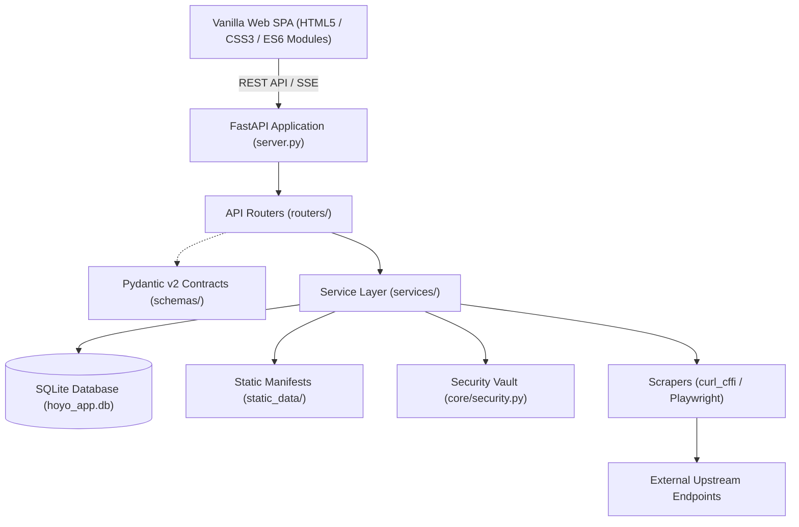

# Cabeça de Droid

<p align="center">
  <b>Language / Idioma:</b> <a href="README.md">🇺🇸 English</a> | <a href="README.pt-BR.md">🇧🇷 Português (Brasil)</a>
</p>

[](https://www.python.org/)
[](https://fastapi.tiangolo.com/)
[](LICENSE)
[](tests/)
[](SECURITY.md)

Cabeça de Droid is a local metagame analysis application for Honkai: Star Rail that executes automated metagame data scraping, deterministic relic Roll Value (RV) scoring, and programmatic tier list rendering.

> [!NOTE]
> **Name Origin:** "Cabeça de Droid" (Droid Head) references *Honkai: Star Rail* lore — the title given by Herta to the **Aeon Nous** (the Aeon of Erudition), an astronomical supercomputer elevated to divinity.

---

## 1. Core Features

- **Metagame Data Ingestion:** Automated data scraping via `curl_cffi` (impersonating browser TLS fingerprints to avoid 403 CDN blocks) targeting upstream community databases and metagame guides. Scraped records are normalized and written to offline JSON manifests under `static_data/`.
- **Relic Roll Value (RV) Engine:** Deterministic substat scoring model evaluating 5★ relics against canonical roll limits, weighted by character archetype, path, and designated stat priorities. Incorporates primary stat forgiveness (+40% baseline credit) and flat-to-percent fallback weights.
- **Programmatic Tier List & Build Cards:** Real-time 2400 × 1350 px (2x HD) canvas rendering for character build overviews, relic roll distributions, account gear audits, and evolution diffs without external frontend frameworks.
- **Endgame Compatibility Matcher:** Algorithmic comparison matching active Memory of Chaos (MoC), Pure Fiction (PF), and Apocalyptic Shadow (AS) compositions against user roster data in SQLite, reporting readiness ratings and functional character substitutions.
- **Warp & Resource Tracking:** Standard UIGF v2.4 / SRGF warp log import and export, exact pity counters (guaranteed vs 50/50), Monte Carlo pull probability projections, and countdown timers aligned with official HoYoverse banner schedules.
- **Cryptographic Credential Vault:** Zero-exposure session storage using Windows DPAPI or AES-256-GCM / HMAC on Linux. Session tokens (`ltuid_v2`, `ltoken_v2`) are masked in web interfaces and stripped from logs by regex filters.

---

## 2. Roll Value (RV) Calculation Methodology

### 2.1 Mathematical Formulation

The Roll Value of an individual substat roll is defined as the ratio between the observed numerical value and the maximum possible single roll value for a 5★ relic:

$$RV_i = \frac{\text{Observed Substat Value}_i}{\text{Max 5★ Roll Value}_i}$$

Each piece is scored by summing the weighted Roll Values of its active substats:

$$\text{Substat Score} = \sum_{i=1}^{n} \left( RV_i \times W_i \right)$$

Where $W_i \in [0.0, 1.0]$ represents the weight assigned to substat $i$ based on the character's path and build archetype:
- **Priority 1 Substat:** $W = 1.00$
- **Priority 2 Substat:** $W = 0.85$
- **Priority 3 Substat:** $W = 0.70$
- **Priority 4 Substat:** $W = 0.55$
- **Priority 5 Substat:** $W = 0.40$
- **Off-Stat / Secondary Pool:** $W = 0.30$
- **Flat Stat Fallback:** Flat ATK, Flat HP, and Flat DEF automatically receive $50\%$ of their corresponding percentage stat weight if the percentage variant is prioritized.

### 2.2 Primary Stat Forgiveness

Primary stats on slots with randomized types (Body, Feet, Planar Sphere, Link Rope) are evaluated as follows:
- **Recommended Primary Stat:** $+40\%$ baseline credit added to the piece rating.
- **Secondary / Viable Primary Stat:** $+24\%$ baseline credit.
- **Non-Viable Primary Stat:** $0\%$ baseline credit.
- **Fixed Primary Slots (Head: Flat HP, Hands: Flat ATK):** Base credit is fixed at $30\%$, with the remaining $70\%$ allocated to substats.

### 2.3 Account Build Score

The overall build score evaluates all designated equipment slots ($N_{\text{slots}} = 6$ for Honkai: Star Rail):

$$\text{Overall Build Score} = \frac{\sum_{k=1}^{N_{\text{equipped}}} \text{Piece Score}_k}{N_{\text{total slots}}}$$

Unassigned equipment slots contribute $0.0$, proportionally lowering incomplete builds.

### 2.4 Rating Scale

| Grade | Score Interval | Classification |
| :---: | :---: | :--- |
| **SSS** | $\ge 90.0\%$ | Optimal rolls across all priority stats |
| **SS** | $75.0\% - 89.9\%$ | High-investment build; minimal stat waste |
| **S** | $60.0\% - 74.9\%$ | Battle-ready endgame benchmark |
| **A** | $45.0\% - 59.9\%$ | Functional build; acceptable substat spread |
| **B** | $30.0\% - 44.9\%$ | Transitional gear; missing core rolls |
| **C** | $15.0\% - 29.9\%$ | Low efficiency; incorrect main stats or rolls |
| **D** | $< 15.0\%$ | Unviable build; immediate replacement candidate |

### 2.5 Canonical 5★ Substat Roll Baselines (Honkai: Star Rail)

| Substat | Minimum Roll | Average Roll | Maximum Roll (1.0 RV) |
| :--- | :---: | :---: | :---: |
| **CRIT Rate** | 2.59% | 2.91% | 3.24% |
| **CRIT DMG** | 5.18% | 5.83% | 6.48% |
| **SPD** | 2.00 | 2.30 | 2.60 |
| **Break Effect** | 5.18% | 5.83% | 6.48% |
| **Effect Hit Rate (EHR)** | 3.45% | 3.88% | 4.32% |
| **Effect RES** | 3.45% | 3.88% | 4.32% |
| **ATK%** | 3.45% | 3.88% | 4.32% |
| **HP%** | 3.45% | 3.88% | 4.32% |
| **DEF%** | 4.32% | 4.86% | 5.40% |
| **Flat ATK** | 17.00 | 19.15 | 21.30 |
| **Flat HP** | 33.80 | 38.05 | 42.30 |
| **Flat DEF** | 17.00 | 19.15 | 21.30 |

---

## 3. Architecture & Technologies



### Component Stack

- **Backend:** Python 3.10+, FastAPI, Pydantic v2, Uvicorn.
- **Scraping & Ingestion:** `curl_cffi` (browser TLS/JA3 fingerprint impersonation), BeautifulSoup4, Playwright Chromium.
- **Data Persistence:** SQLite (`hoyo_app.db`) with native JSON manifests as offline fallback caches (`static_data/`).
- **Security:** Windows Data Protection API (DPAPI via `ctypes.windll.crypt32`) and AES-256-GCM fallback on POSIX environments.
- **Frontend:** Vanilla HTML5, CSS3 with standard CSS variables, and modular ES6 JavaScript without external build frameworks.

---

## 4. Prerequisites & Installation

### Requirements
- Python 3.10 or higher
- Git

### Quick Setup

```bash
# 1. Clone repository
git clone https://github.com/Lacas0010/Cabeca_de_Droid.git
cd Cabeca_de_Droid

# 2. Configure virtual environment
python -m venv .venv

# Windows PowerShell:
.\.venv\Scripts\Activate.ps1
# Linux / macOS:
source .venv/bin/activate

# 3. Install dependencies
pip install -r requirements.txt
playwright install chromium

# 4. Launch web service
python main.py
```

Default access URL: `http://127.0.0.1:8000`

---

## 5. Self-Hosted Deployment

### 5.1 Systemd Service (Linux)

Create `/etc/systemd/system/cabeca-de-droid.service`:

```ini
[Unit]
Description=Cabeca de Droid Metagame Service
After=network.target

[Service]
Type=simple
User=ubuntu
WorkingDirectory=/home/ubuntu/Cabeca_de_Droid
ExecStart=/home/ubuntu/Cabeca_de_Droid/.venv/bin/python main.py --host 0.0.0.0 --port 8000 --no-browser
Restart=always
RestartSec=5
Environment=PYTHONUNBUFFERED=1

[Install]
WantedBy=multi-user.target
```

Enable and start the service:

```bash
sudo systemctl daemon-reload
sudo systemctl enable cabeca-de-droid
sudo systemctl start cabeca-de-droid
```

### 5.2 Container Deployment (OCI / Docker)

A minimal deployment Dockerfile:

```dockerfile
FROM python:3.11-slim

WORKDIR /app

RUN apt-get update && apt-get install -y --no-install-recommends \
    curl git && \
    rm -rf /var/lib/apt/lists/*

COPY requirements.txt .
RUN pip install --no-cache-dir -r requirements.txt && \
    playwright install-deps chromium && \
    playwright install chromium

COPY . .

EXPOSE 8000

CMD ["python", "main.py", "--host", "0.0.0.0", "--port", "8000", "--no-browser"]
```

Build and run:

```bash
docker build -t cabeca-de-droid .
docker run -d -p 8000:8000 -v $(pwd)/hoyo_app.db:/app/hoyo_app.db cabeca-de-droid
```

---

## 6. Configuration & CLI Parameters

| Parameter | Type | Default | Description |
| :--- | :---: | :---: | :--- |
| `--host` | `str` | `127.0.0.1` | Network interface binding (`0.0.0.0` for LAN access). |
| `--port` | `int` | `8000` | TCP listening port. |
| `--lan` | `flag` | `False` | Shortcut to bind `--host 0.0.0.0`. |
| `--no-browser` | `flag` | `False` | Disables automated default browser launch on startup. |
| `--no-tray` | `flag` | `False` | Disables Windows system tray taskbar icon integration. |

---

## 7. REST API Reference

| Method | Endpoint | Description |
| :--- | :--- | :--- |
| `GET` | `/api/overview` | Unified account metadata, resin levels, and active rosters. |
| `GET` | `/api/roster/{game_id}` | Full character roster with computed Roll Value and gear scores. |
| `GET` | `/api/build/{game_id}/{char_name}` | Equipment breakdown, traces, skills, and Eidolon progression. |
| `GET` | `/api/compare/{game_id}/{char_name}` | Deterministic build audit against community benchmark targets. |
| `POST` | `/api/sync/{game_id}` | Triggers background synchronization of roster and guide manifests. |
| `GET` | `/api/endgame/{game_id}` | Cleared stages, star counts, and cycle metrics for endgame modes. |
| `GET` | `/api/endgame/team-match/{game_id}` | Archetype team compatibility calculations and substitute ranking. |
| `POST` | `/api/gacha/forecast/calculate` | Monte Carlo warp forecast calculation. |
| `GET` | `/api/notes` | Real-time stamina, daily quest, and expedition counters. |
| `POST` | `/api/checkin/run` | Executes HoYoLAB daily check-in sequence. |
| `GET` | `/api/static-data/status` | Ingestion status and checksum metadata for offline JSON manifests. |

---

## 8. License & Contributing

- **License:** Distributed under the [MIT License](LICENSE).
- **Contributing:** Submit technical pull requests targeting `main`. Code contributions must pass automated linting (`ruff check .`), formatting (`ruff format --check .`), type checking (`mypy schemas/ services/`), and the unit test suite (`python -m unittest discover tests`). Detailed workflow rules are documented in [CONTRIBUTING.md](CONTRIBUTING.md).
- **Security Disclosures:** For vulnerability reporting and cryptographic vault specifications, refer to [SECURITY.md](SECURITY.md).
