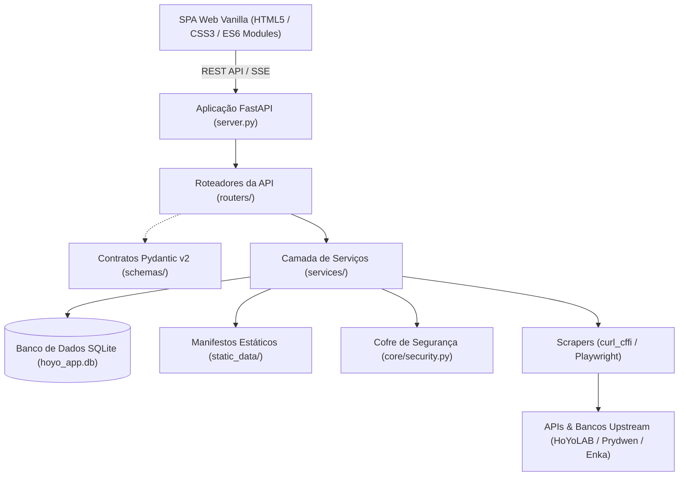

# Cabeça de Droid

<p align="center">
  <b>Idioma / Language:</b> <a href="README.pt-BR.md">🇧🇷 Português (Brasil)</a> | <a href="README.md">🇺🇸 English</a>
</p>

[](https://www.python.org/)
[](https://fastapi.tiangolo.com/)
[](LICENSE)
[](tests/)
[](SECURITY.md)

O Cabeça de Droid é um serviço local de análise de metagame e gerenciamento multijogos para **Honkai: Star Rail**, **Genshin Impact** e **Zenless Zone Zero** que fornece ingestão automatizada de dados do meta, avaliação determinística de Valor de Rolagem (RV) de equipamentos, projeção probabilística de gacha via simulação de Monte Carlo e renderização programática de auditorias de build.

> [!NOTE]
> **Origem do Nome:** "Cabeça de Droid" faz referência à lore de *Honkai: Star Rail* — o título concedido por Herta ao **Aeon Nous** (o Aeon da Erudição), um supercomputador astronômico elevado à divindade.

---

## 1. Módulos Principais & Funcionalidades

### 1.1 Ingestão Multijogos de Dados do Metagame
- **Extração Automatizada Upstream:** Utiliza `curl_cffi` com personificação de fingerprints TLS/JA3 de navegadores para contornar bloqueios 403 de CDNs, coletando guias de personagens, tier lists de equipamentos e métricas de rotação de bases consolidadas da comunidade (Prydwen, Enka Network, HoYoLAB).
- **Raspagem Dinâmica de Banners de Personagens e Equipamentos:** Analisa em tempo real os banners ativos de personagens e armas/cones/motores (incluindo *Invocação do Epítome*, *Fixação Brilhante* e *Sonata Dissonante*) para os três jogos, salvando registros normalizados no manifesto offline `static_data/current_banners.json`.
- **Cache Determinístico Offline:** O sistema opera autonomamente a partir de manifestos JSON estáticos locais caso a conexão externa de rede esteja indisponível.

### 1.2 Motor Determinístico de Valor de Rolagem (RV) de Equipamentos
- **Avaliação Multijogos:**
  - *Honkai: Star Rail:* Pontuação de Relíquias e Ornamentos Planos contra os limites canônicos de rolagem 5★.
  - *Genshin Impact:* Avaliação de Artefatos (Flor, Pluma, Areia, Cálice, Tiara) ponderados pelas escalas do personagem (ATQ, Vida, DEF, Recarga, Proficiência, Críticos).
  - *Zenless Zone Zero:* Avaliação de Discos de Drive (Espaços 1 a 6) considerando atributos principais, Proficiência de Anomalia e dispersão de Críticos.
- **Ponderação por Função de Combate:** Cada substatus recebe pesos determinísticos ($1.00$ a $0.40$) derivados dos benchmarks da comunidade.
- **Tolerância de Atributo Principal (Primary Stat Forgiveness):** Concede $+40\%$ de crédito base para o atributo principal recomendado, $+24\%$ para opções secundárias viáveis e $0\%$ para tipos incompatíveis.
- **Fallback para Atributos Planos (Flat):** ATQ Plano, Vida Plana e DEF Plana recebem automaticamente $50\%$ do peso do respectivo atributo percentual caso este seja priorizado.

### 1.3 Simulador de Gacha & Projeção Monte Carlo
- **Modelagem Estocástica com 10.000 Iterações:** Simula curvas exatas de probabilidade, média de invocações e intervalos de confiança para obtenção de cópias de personagens (C0–C6 / E0–E6 / M0–M6) e armas/cones/motores característicos (R1–R5).
- **Mecânicas Oficiais Fidelizadas:** Implementa curvas reais de Soft Pity (iniciando no tiro 74 em banners de personagens, tiro 63 no banner de armas do Genshin e tiro 65 nos cones de luz de HSR), taxas base (0.6% / 0.8% / 1.0%), alternância de 50/50 garantido e regras de Pontos de Destino / Caminho Divino.
- **Projeção de Acúmulo de Recursos:** Projeta ganhos diários e mensais de moedas de invocação (Missões Diárias, Resets Mensais da Loja, resets do Abismo/MoC/Shiyu, eventos sazonais e Bênção da Lua Nova / Passe de Suprimentos).
- **Rastreador de Histórico de Saltos, Orações e Sinais:** Importação e exportação nos padrões universais UIGF v2.4 e SRGF, calculando contadores de pity em nível de conta e percentual de sorte histórica.

### 1.4 Planejador de Cultivo Diário (Ordem de Serviço)
- **Mapeamento de Rotação de Domínios:** Mapeia domínios abertos de livros de talentos, materiais de ascensão de armas e rastros de acordo com o dia oficial do servidor.
- **Alocação Priorizada por Roster:** Cruza os domínios em rotação com personagens abaixo dos limiares de nível/build no elenco do usuário, gerando uma ordem diária priorizada de gasto de resina, poder de desbravamento e bateria.
- **Exportação de Roteiro:** Permite copiar ou despachar roteiros de cultivo diário diretamente para webhooks de Discord e Telegram.

### 1.5 Filtro de Descarte de Equipamentos (Trash Finder) & Conselheiro de Síntese
- **Identificação de Peças para Descarte:** Audita peças desequipadas e bloqueadas contra os requisitos de todos os personagens indexados, indicando peças com atributos conflitantes ou baixo Valor de Rolagem para conversão em EXP ou reciclagem.
- **Conselheiro de Síntese Personalizada:** Recomenda a criação direcionada de peças utilizando *Resina Automodeladora* (HSR), *Elixir Santificador* (Genshin) ou *Sintetizador/Desmanche* (ZZZ) focando nos espaços de menor pontuação da equipe ativa.

### 1.6 Índice de Eficiência de Rolagens da Conta (Índice de Sorte)
- **Dispersão Estatística de Substatus:** Avalia a qualidade de rolagem da conta medindo a variância entre as rolagens observadas e o teto canônico 5★ em todas as peças equipadas.
- **Identificação de Recordes:** Destaca a melhor peça obtida na conta (**God Roll**) e a peça de menor aproveitamento matemático (**Cursed Roll**).

### 1.7 Tier List Programática & Cards de Build
- **Matriz de Investimento da Conta:** Classifica o elenco indexado em notas padronizadas (**SSS** a **D**) com diagnósticos de cobertura elemental e distribuição de papéis de combate.
- **Exportação 2x HD em Canvas:** Renderiza cards de personagens, distribuições de rolagem e resumos de times em resolução 2400 × 1350 px de alta fidelidade sem dependências de frameworks pesados no cliente.

### 1.8 Compatibilidade de Desafios de Fim de Jogo (Endgame) & Team Matcher
- **Auditoria de Desafios:** Monitora andares concluídos, tempos, contagem de ciclos e estrelas obtidas no *Caos da Memória (MoC)*, *Ficção Pura (PF)*, *Sombra Apocalíptica (AS)*, *Espiral do Abismo*, *Teatro Imaginário* e *Defesa Shiyu*.
- **Correspondência Algorítmica de Times:** Cruza composições consagradas do meta com os personagens reais do usuário em SQLite, calculando a porcentagem de prontidão do time e sugerindo substituições operacionais viáveis.

### 1.9 Linha do Tempo & Snapshots de Evolução da Conta
- **Histórico Temporal de Progresso:** Armazena snapshots periódicos de atributos do elenco, pontuações de equipamentos e níveis de conta.
- **Diferenciais de Evolução (Diffing):** Exibe comparativos de crescimento de atributos, aquisição de novos 5★ e progressão de nota de relíquias ao longo do tempo.

### 1.10 Resgate Autônomo de Códigos Promocionais & Alertas
- **Resgate Periódico a Cada 3 Horas:** Localiza e resgata automaticamente novos códigos promocionais de Gemas Essenciais, Jades Estelares e Polychromes via API do HoYoLAB.
- **Notificações Proativas:** Envia notificações na Área de Trabalho (Windows Toast), Webhooks no Discord e alertas no Telegram quando a energia atinge o teto máximo, códigos são resgatados ou novos banners entram em vigor.

### 1.11 Cofre Criptográfico de Credenciais
- **Premissa Zero-Exposure:** Protege tokens de autenticação (`ltuid_v2`, `ltoken_v2`) utilizando a Windows Data Protection API (DPAPI) ou criptografia AES-256-GCM / HMAC em sistemas POSIX.
- **Garantia de Privacidade:** Tokens são mascarados na interface web (`mask_token`) e expurgados de qualquer saída de log via expressões regulares. Controle opcional de acesso local por PIN numérico.

---

## 2. Metodologia de Cálculo de Valor de Rolagem (RV)

### 2.1 Formulação Matemática

O Valor de Rolagem (Roll Value - RV) de um substatus individual é definido pela razão entre o valor numérico observado e o valor máximo possível de uma rolagem única em um item 5★:

$$RV_i = \frac{\text{Valor Observado do Substatus}_i}{\text{Valor Máximo de Rolagem 5★}_i}$$

A pontuação de cada peça é obtida pela somatória ponderada dos Valores de Rolagem de seus substatus ativos:

$$\text{Pontuação de Substatus da Peça} = \sum_{i=1}^{n} \left( RV_i \times W_i \right)$$

Onde $W_i \in [0.0, 1.0]$ representa o peso atribuído ao substatus $i$ conforme o Caminho, escala de combate e arquétipo de build do personagem:
- **Substatus Prioridade 1:** $W = 1.00$
- **Substatus Prioridade 2:** $W = 0.85$
- **Substatus Prioridade 3:** $W = 0.70$
- **Substatus Prioridade 4:** $W = 0.55$
- **Substatus Prioridade 5:** $W = 0.40$
- **Atributos Secundários / Reserva:** $W = 0.30$
- **Fallback para Atributos Planos (Flat):** ATK Plano, Vida Plana e DEF Plana recebem automaticamente $50\%$ do peso do respectivo atributo percentual caso este seja priorizado.

### 2.2 Tolerância de Atributo Principal (Primary Stat Forgiveness)

Atributos principais em espaços com tipos variáveis são avaliados da seguinte forma:
- **Atributo Principal Recomendado:** $+40\%$ de crédito base adicionado à pontuação da peça.
- **Atributo Principal Secundário / Viável:** $+24\%$ de crédito base.
- **Atributo Principal Inviável:** $0\%$ de crédito base.
- **Espaços com Atributo Principal Fixo:** O crédito base é fixado em $30\%$, com os $70\%$ restantes distribuídos para os substatus.

### 2.3 Pontuação Geral de Build da Conta

A pontuação consolidada da build avalia todos os espaços de equipamento designados ($N_{\text{espaços}} = 6$ para HSR e ZZZ, $N_{\text{espaços}} = 5$ para Genshin Impact):

$$\text{Pontuação Geral da Build} = \frac{\sum_{k=1}^{N_{\text{equipados}}} \text{Pontuação da Peça}_k}{N_{\text{espaços totais}}}$$

Espaços vazios contribuem com $0.0$, penalizando proporcionalmente builds incompletas.

### 2.4 Escala de Classificação

| Classificação | Intervalo de Pontuação | Critério Técnico |
| :---: | :---: | :--- |
| **SSS** | $\ge 90.0\%$ | Rolagens ótimas em todos os atributos prioritários; máxima eficiência |
| **SS** | $75.0\% - 89.9\%$ | Alto investimento; desperdício mínimo de atributos |
| **S** | $60.0\% - 74.9\%$ | Padrão competitivo pronto para modos de fim de jogo |
| **A** | $45.0\% - 59.9\%$ | Build funcional; distribuição aceitável de substatus |
| **B** | $30.0\% - 44.9\%$ | Equipamento de transição; ausência de rolagens essenciais |
| **C** | $15.0\% - 29.9\%$ | Baixa eficiência; atributos principais ou rolagens incorretas |
| **D** | $< 15.0\%$ | Inviável; indicação para substituição imediata |

### 2.5 Valores Base Canônicos de Rolagens 5★

#### Honkai: Star Rail (Relíquias 5★)

| Substatus | Rolagem Mínima | Rolagem Média | Rolagem Máxima (1.0 RV) |
| :--- | :---: | :---: | :---: |
| **Taxa Crítica** | 2.59% | 2.91% | 3.24% |
| **Dano Crítico** | 5.18% | 5.83% | 6.48% |
| **VEL** | 2.00 | 2.30 | 2.60 |
| **Efeito de Quebra** | 5.18% | 5.83% | 6.48% |
| **Taxa de Acerto de Efeito (EHR)** | 3.45% | 3.88% | 4.32% |
| **Resistência a Efeito (RES)** | 3.45% | 3.88% | 4.32% |
| **ATK% / HP%** | 3.45% | 3.88% | 4.32% |
| **DEF%** | 4.32% | 4.86% | 5.40% |
| **ATK Plano / DEF Plano** | 17.00 | 19.15 | 21.30 |
| **HP Plano** | 33.80 | 38.05 | 42.30 |

#### Genshin Impact (Artefatos 5★)

| Substatus | Rolagem Mínima | Rolagem Média | Rolagem Máxima (1.0 RV) |
| :--- | :---: | :---: | :---: |
| **Taxa Crítica** | 2.72% | 3.30% | 3.89% |
| **Dano Crítico** | 5.44% | 6.61% | 7.77% |
| **Recarga de Energia** | 4.53% | 5.51% | 6.48% |
| **Proficiência Elemental** | 16.32 | 19.82 | 23.31 |
| **ATK% / HP%** | 4.08% | 4.96% | 5.83% |
| **DEF%** | 5.10% | 6.20% | 7.29% |
| **ATK Plano** | 13.62 | 16.54 | 19.45 |
| **HP Plano** | 209.13 | 253.94 | 298.75 |
| **DEF Plano** | 16.20 | 19.68 | 23.15 |

#### Zenless Zone Zero (Discos de Drive Rank S)

| Substatus | Rolagem Mínima | Rolagem Média | Rolagem Máxima (1.0 RV) |
| :--- | :---: | :---: | :---: |
| **Taxa Crítica** | 2.40% | 2.70% | 3.00% |
| **Dano Crítico** | 4.80% | 5.40% | 6.00% |
| **Taxa de Penetração (PEN)** | 9.00 | 10.50 | 12.00 |
| **Proficiência de Anomalia** | 9.00 | 10.50 | 12.00 |
| **ATK% / HP%** | 2.40% | 2.70% | 3.00% |
| **DEF%** | 3.84% | 4.32% | 4.80% |
| **ATK Plano / DEF Plano** | 15.00 | 17.50 | 20.00 |
| **HP Plano** | 90.00 | 102.50 | 115.00 |

---

## 3. Arquitetura e Tecnologias



### Componentes da Stack
- **Backend:** Python 3.10+, FastAPI, Pydantic v2, Uvicorn.
- **Raspagem & Ingestão:** `curl_cffi` (personificação de TLS/JA3 de navegadores), BeautifulSoup4, Playwright Chromium.
- **Persistência de Dados:** SQLite (`hoyo_app.db`) com manifestos JSON offline (`static_data/`).
- **Segurança:** Windows Data Protection API (DPAPI via `ctypes.windll.crypt32`) com fallback para AES-256-GCM / HMAC em sistemas POSIX.
- **Frontend:** HTML5 semântico, CSS3 com variáveis nativas e JavaScript modular ES6+, sem dependência de transpiladores ou frameworks externos.

---

## 4. Pré-requisitos e Instalação Rápida

### Requisitos de Sistema
- Python 3.10 ou superior
- Git
- Chromium (instalado via Playwright)

### Procedimento de Instalação

```bash
# 1. Clonar repositório
git clone https://github.com/Lacas0010/Cabeca_de_Droid.git
cd Cabeca_de_Droid

# 2. Configurar ambiente virtual
python -m venv .venv

# Windows PowerShell:
.\.venv\Scripts\Activate.ps1
# Linux / macOS:
source .venv/bin/activate

# 3. Instalar dependências
pip install -r requirements.txt
playwright install chromium

# 4. Iniciar o serviço web
python main.py
```

URL de acesso local: `http://127.0.0.1:8000`

---

## 5. Implantação Autohospedada (Self-Hosted)

### 5.1 Serviço Systemd (Linux)

Crie o arquivo `/etc/systemd/system/cabeca-de-droid.service`:

```ini
[Unit]
Description=Serviço de Metagame Cabeca de Droid
After=network.target

[Service]
Type=simple
User=ubuntu
WorkingDirectory=/home/ubuntu/Cabeca_de_Droid
ExecStart=/home/ubuntu/Cabeca_de_Droid/.venv/bin/python main.py --host 0.0.0.0 --port 8000 --no-browser
Restart=always
RestartSec=5
Environment=PYTHONUNBUFFERED=1

[Install]
WantedBy=multi-user.target
```

Habilitar e iniciar a unidade de serviço:

```bash
sudo systemctl daemon-reload
sudo systemctl enable cabeca-de-droid
sudo systemctl start cabeca-de-droid
```

### 5.2 Implantação em Contêiner (OCI / Docker)

```dockerfile
FROM python:3.11-slim

WORKDIR /app

RUN apt-get update && apt-get install -y --no-install-recommends \
    curl git && \
    rm -rf /var/lib/apt/lists/*

COPY requirements.txt .
RUN pip install --no-cache-dir -r requirements.txt && \
    playwright install-deps chromium && \
    playwright install chromium

COPY . .

EXPOSE 8000

CMD ["python", "main.py", "--host", "0.0.0.0", "--port", "8000", "--no-browser"]
```

Compilação e execução:

```bash
docker build -t cabeca-de-droid .
docker run -d -p 8000:8000 -v $(pwd)/hoyo_app.db:/app/hoyo_app.db cabeca-de-droid
```

---

## 6. Configuração e Parâmetros de Linha de Comando (CLI)

| Parâmetro | Tipo | Padrão | Descrição |
| :--- | :---: | :---: | :--- |
| `--host` | `str` | `127.0.0.1` | Interface de rede para vinculação (`0.0.0.0` para rede local). |
| `--port` | `int` | `8000` | Porta TCP de escuta. |
| `--lan` | `flag` | `False` | Atalho para vincular a `--host 0.0.0.0`. |
| `--no-browser` | `flag` | `False` | Desativa a abertura automática do navegador na inicialização. |
| `--no-tray` | `flag` | `False` | Desativa o ícone na bandeja do sistema (Windows Taskbar Tray). |

---

## 7. Referência da API REST

| Método | Endpoint | Descrição |
| :--- | :--- | :--- |
| `GET` | `/api/overview` | Metadados consolidados de contas, níveis de energia e elenco ativo nos 3 jogos. |
| `GET` | `/api/roster/{game_id}` | Elenco completo com Valores de Rolagem calculados e notas de equipamento. |
| `GET` | `/api/build/{game_id}/{char_name}` | Detalhamento de equipamentos, habilidades, rastros/talentos e progressão. |
| `GET` | `/api/compare/{game_id}/{char_name}` | Auditoria determinística de build contra metas e referências da comunidade. |
| `POST` | `/api/sync/{game_id}` | Dispara sincronização em segundo plano do elenco e manifestos de guias. |
| `GET` | `/api/endgame/{game_id}` | Fases concluídas, contagem de estrelas e ciclos utilizados em modos de fim de jogo. |
| `GET` | `/api/endgame/team-match/{game_id}` | Cálculo de compatibilidade de arquétipos de times e substitutos recomendados. |
| `GET` | `/api/gacha/current-banners` | Banners ativos de personagens e armas extraídos dinamicamente do Prydwen. |
| `POST` | `/api/gacha/current-banners/sync` | Força a raspagem atualizada em tempo real dos banners ativos. |
| `GET` | `/api/gacha/defaults/{game_id}` | Parâmetros padrão do simulador (pity, estado de garantido, item em destaque). |
| `POST` | `/api/gacha/calculate` | Cálculo de probabilidade gacha via simulação de Monte Carlo (10.000 iterações). |
| `POST` | `/api/gacha/forecast/calculate` | Cálculo de projeção de acúmulo de recursos e metas de banners futuros. |
| `GET` | `/api/gacha/tracker/{game_id}` | Histórico de saltos/orações/sinais com distribuição e contadores de pity. |
| `POST` | `/api/gacha/tracker/import` | Importação de registros nos formatos padronizados UIGF v2.4 e SRGF. |
| `GET` | `/api/farming/today` | Domínios abertos hoje e ordem de serviço priorizada de gasto de energia. |
| `GET` | `/api/trash/{game_id}` | Filtro de descarte identificando peças com atributos conflitantes ou baixo RV. |
| `GET` | `/api/luck/{game_id}` | Métricas de eficiência de rolagem da conta com identificação de God Roll e Cursed Roll. |
| `GET` | `/api/notes` | Contadores em tempo real de resina/energia, missões diárias e expedições. |
| `POST` | `/api/checkin/run` | Executa rotina de check-in diário no HoYoLAB. |
| `GET` | `/api/codes` | Códigos promocionais ativos com histórico de resgate e status do auto-redeem. |
| `GET` | `/api/static-data/status` | Estado de ingestão e somas de verificação (checksums) dos manifestos JSON offline. |

---

## 8. Licença e Contribuição

- **Licença:** Distribuído sob a [Licença MIT](LICENSE).
- **Contribuição:** Solicitações de pull (PR) direcionadas à branch `main` devem passar na validação de linter (`ruff check .`), formatação (`ruff format --check .`), tipagem estática (`mypy schemas/ services/`) e na suíte de testes unitários (`python -m unittest discover tests`). Diretrizes detalhadas de fluxo de trabalho estão documentadas em [CONTRIBUTING.md](CONTRIBUTING.md).
- **Relatório de Vulnerabilidades:** Para relatórios de segurança e especificações do cofre criptográfico, consulte [SECURITY.md](SECURITY.md).
