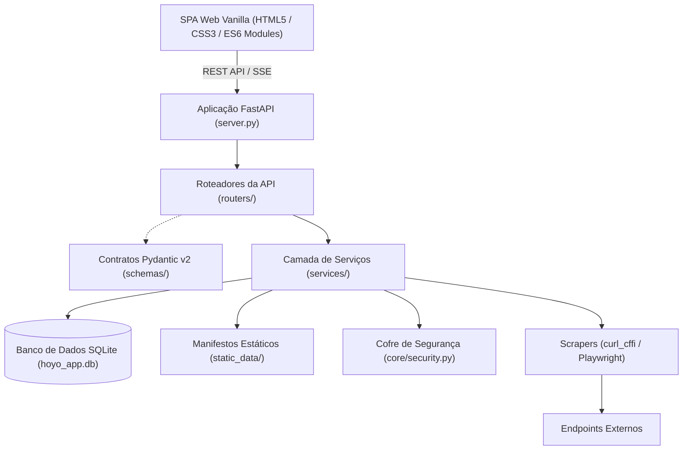

# Cabeça de Droid

<p align="center">
  <b>Idioma / Language:</b> <a href="README.pt-BR.md">🇧🇷 Português (Brasil)</a> | <a href="README.md">🇺🇸 English</a>
</p>

[](https://www.python.org/)
[](https://fastapi.tiangolo.com/)
[](LICENSE)
[](tests/)
[](SECURITY.md)

O Cabeça de Droid é uma aplicação local de análise de metagame para Honkai: Star Rail que executa raspagem automatizada de dados do meta, pontuação determinística de Valor de Rolagem (RV) de relíquias e renderização programática de tier lists.

> [!NOTE]
> **Origem do Nome:** "Cabeça de Droid" faz referência à lore de *Honkai: Star Rail* — o título concedido por Herta ao **Aeon Nous** (o Aeon da Erudição), um supercomputador astronômico elevado à divindade.

---

## 1. Funcionalidades Principais

- **Ingestão de Dados do Metagame:** Extração automatizada de dados via `curl_cffi` (com personificação de fingerprints TLS de navegadores para contornar bloqueios 403 de CDNs), coletando dados de bases comunitárias e guias consolidados. Os registros extraídos são normalizados e persistidos em manifestos JSON offline no diretório `static_data/`.
- **Motor de Valor de Rolagem (RV) de Relíquias:** Modelo de pontuação determinística que avalia substatus de relíquias 5★ contra limites canônicos de rolagem, ponderados por arquétipo, Caminho e prioridades de atributos do personagem. Inclui tolerância de atributo principal (+40% de crédito base) e pesos de fallback para atributos planos (Flat stats).
- **Tier Lists Programáticas e Cards de Build:** Renderização de alta fidelidade em canvas 2400 × 1350 px (2x HD) para visão geral de builds, dispersão de rolagens de relíquias, auditoria de equipamentos e diferenciais de evolução sem frameworks de frontend externos.
- **Correspondência de Modos de Fim de Jogo (Endgame):** Comparação algorítmica entre composições do Caos da Memória (MoC), Ficção Pura (PF) e Sombra Apocalíptica (AS) contra o elenco de personagens do usuário em SQLite, calculando prontidão operacional e sugerindo substituições viáveis.
- **Rastreamento de Saltos (Warp) e Recursos:** Importação e exportação nos padrões UIGF v2.4 e SRGF, contadores exatos de pity (garantido vs 50/50), projeções probabilísticas via simulação de Monte Carlo e contadores regressivos sincronizados com cronogramas oficiais de banners da HoYoverse.
- **Cofre Criptográfico de Credenciais:** Armazenamento seguro de sessões com premissa Zero-Exposure via Windows DPAPI ou AES-256-GCM / HMAC em sistemas Linux. Tokens de autenticação (`ltuid_v2`, `ltoken_v2`) são mascarados na interface e expurgados dos logs por filtros regex.

---

## 2. Metodologia de Cálculo de Valor de Rolagem (RV)

### 2.1 Formulação Matemática

O Valor de Rolagem (Roll Value - RV) de um substatus individual é definido pela razão entre o valor numérico observado e o valor máximo possível de uma rolagem única em uma relíquia 5★:

$$RV_i = \frac{\text{Valor Observado do Substatus}_i}{\text{Valor Máximo de Rolagem 5★}_i}$$

A pontuação de cada peça é obtida pela somatória ponderada dos Valores de Rolagem de seus substatus ativos:

$$\text{Pontuação de Substatus} = \sum_{i=1}^{n} \left( RV_i \times W_i \right)$$

Onde $W_i \in [0.0, 1.0]$ representa o peso atribuído ao substatus $i$ conforme o Caminho e o arquétipo de build do personagem:
- **Substatus Prioridade 1:** $W = 1.00$
- **Substatus Prioridade 2:** $W = 0.85$
- **Substatus Prioridade 3:** $W = 0.70$
- **Substatus Prioridade 4:** $W = 0.55$
- **Substatus Prioridade 5:** $W = 0.40$
- **Atributos Secundários / Reserva:** $W = 0.30$
- **Fallback para Atributos Planos (Flat):** ATK Plano, HP Plano e DEF Plano recebem automaticamente $50\%$ do peso do respectivo atributo percentual caso este seja priorizado.

### 2.2 Tolerância de Atributo Principal (Primary Stat Forgiveness)

Atributos principais em espaços com tipos variáveis (Corpo, Pés, Esfera Planar, Corda de Ligação) são avaliados da seguinte forma:
- **Atributo Principal Recomendado:** $+40\%$ de crédito base adicionado à pontuação da peça.
- **Atributo Principal Secundário / Viável:** $+24\%$ de crédito base.
- **Atributo Principal Inviável:** $0\%$ de crédito base.
- **Espaços com Atributo Principal Fixo (Cabeça: HP Plano, Mãos: ATK Plano):** O crédito base é fixado em $30\%$, com os $70\%$ restantes distribuídos para os substatus.

### 2.3 Pontuação Geral de Build da Conta

A pontuação consolidada da build avalia todos os espaços de equipamento designados ($N_{\text{espaços}} = 6$ para Honkai: Star Rail):

$$\text{Pontuação Geral da Build} = \frac{\sum_{k=1}^{N_{\text{equipados}}} \text{Pontuação da Peça}_k}{N_{\text{espaços totais}}}$$

Espaços vazios contribuem com $0.0$, penalizando proporcionalmente builds incompletas.

### 2.4 Escala de Classificação

| Classificação | Intervalo de Pontuação | Critério Técnico |
| :---: | :---: | :--- |
| **SSS** | $\ge 90.0\%$ | Rolagens ótimas em todos os atributos prioritários |
| **SS** | $75.0\% - 89.9\%$ | Alto investimento; desperdício mínimo de atributos |
| **S** | $60.0\% - 74.9\%$ | Padrão competitivo pronto para modos de fim de jogo |
| **A** | $45.0\% - 59.9\%$ | Build funcional; distribuição aceitável de substatus |
| **B** | $30.0\% - 44.9\%$ | Equipamento de transição; ausência de rolagens essenciais |
| **C** | $15.0\% - 29.9\%$ | Baixa eficiência; atributos principais ou rolagens incorretas |
| **D** | $< 15.0\%$ | Inviável; indicação para substituição imediata |

### 2.5 Valores Base Canônicos de Rolagens 5★ (Honkai: Star Rail)

| Substatus | Rolagem Mínima | Rolagem Média | Rolagem Máxima (1.0 RV) |
| :--- | :---: | :---: | :---: |
| **Taxa Crítica** | 2.59% | 2.91% | 3.24% |
| **Dano Crítico** | 5.18% | 5.83% | 6.48% |
| **VEL** | 2.00 | 2.30 | 2.60 |
| **Efeito de Quebra** | 5.18% | 5.83% | 6.48% |
| **Taxa de Acerto de Efeito (EHR)** | 3.45% | 3.88% | 4.32% |
| **Resistência a Efeito (RES)** | 3.45% | 3.88% | 4.32% |
| **ATK%** | 3.45% | 3.88% | 4.32% |
| **HP%** | 3.45% | 3.88% | 4.32% |
| **DEF%** | 4.32% | 4.86% | 5.40% |
| **ATK Plano** | 17.00 | 19.15 | 21.30 |
| **HP Plano** | 33.80 | 38.05 | 42.30 |
| **DEF Plano** | 17.00 | 19.15 | 21.30 |

---

## 3. Arquitetura e Tecnologias



### Componentes da Stack

- **Backend:** Python 3.10+, FastAPI, Pydantic v2, Uvicorn.
- **Raspagem e Ingestão:** `curl_cffi` (personificação de TLS/JA3 de navegadores), BeautifulSoup4, Playwright Chromium.
- **Persistência de Dados:** SQLite (`hoyo_app.db`) com manifestos JSON puros como cache offline (`static_data/`).
- **Segurança:** Windows Data Protection API (DPAPI via `ctypes.windll.crypt32`) com fallback para AES-256-GCM em ambientes POSIX.
- **Frontend:** HTML5 semântico, CSS3 com variáveis nativas e JavaScript modular ES6+, sem dependência de transpiladores ou frameworks externos.

---

## 4. Pré-requisitos e Instalação Rápida

### Requisitos de Sistema
- Python 3.10 ou superior
- Git

### Procedimento de Instalação

```bash
# 1. Clonar repositório
git clone https://github.com/Lacas0010/Cabeca_de_Droid.git
cd Cabeca_de_Droid

# 2. Configurar ambiente virtual
python -m venv .venv

# Windows PowerShell:
.\.venv\Scripts\Activate.ps1
# Linux / macOS:
source .venv/bin/activate

# 3. Instalar dependências
pip install -r requirements.txt
playwright install chromium

# 4. Iniciar o serviço web
python main.py
```

URL de acesso local: `http://127.0.0.1:8000`

---

## 5. Implantação Autohospedada (Self-Hosted)

### 5.1 Serviço Systemd (Linux)

Crie o arquivo `/etc/systemd/system/cabeca-de-droid.service`:

```ini
[Unit]
Description=Serviço de Metagame Cabeca de Droid
After=network.target

[Service]
Type=simple
User=ubuntu
WorkingDirectory=/home/ubuntu/Cabeca_de_Droid
ExecStart=/home/ubuntu/Cabeca_de_Droid/.venv/bin/python main.py --host 0.0.0.0 --port 8000 --no-browser
Restart=always
RestartSec=5
Environment=PYTHONUNBUFFERED=1

[Install]
WantedBy=multi-user.target
```

Habilitar e iniciar a unidade de serviço:

```bash
sudo systemctl daemon-reload
sudo systemctl enable cabeca-de-droid
sudo systemctl start cabeca-de-droid
```

### 5.2 Implantação em Contêiner (OCI / Docker)

Arquivo `Dockerfile` mínimo para produção:

```dockerfile
FROM python:3.11-slim

WORKDIR /app

RUN apt-get update && apt-get install -y --no-install-recommends \
    curl git && \
    rm -rf /var/lib/apt/lists/*

COPY requirements.txt .
RUN pip install --no-cache-dir -r requirements.txt && \
    playwright install-deps chromium && \
    playwright install chromium

COPY . .

EXPOSE 8000

CMD ["python", "main.py", "--host", "0.0.0.0", "--port", "8000", "--no-browser"]
```

Compilação e execução:

```bash
docker build -t cabeca-de-droid .
docker run -d -p 8000:8000 -v $(pwd)/hoyo_app.db:/app/hoyo_app.db cabeca-de-droid
```

---

## 6. Configuração e Parâmetros de Linha de Comando (CLI)

| Parâmetro | Tipo | Padrão | Descrição |
| :--- | :---: | :---: | :--- |
| `--host` | `str` | `127.0.0.1` | Interface de rede para vinculação (`0.0.0.0` para rede local). |
| `--port` | `int` | `8000` | Porta TCP de escuta. |
| `--lan` | `flag` | `False` | Atalho para vincular a `--host 0.0.0.0`. |
| `--no-browser` | `flag` | `False` | Desativa a abertura automática do navegador na inicialização. |
| `--no-tray` | `flag` | `False` | Desativa o ícone na bandeja do sistema (Windows Taskbar Tray). |

---

## 7. Referência da API REST

| Método | Endpoint | Descrição |
| :--- | :--- | :--- |
| `GET` | `/api/overview` | Metadados consolidados de contas, níveis de resina e elenco ativo. |
| `GET` | `/api/roster/{game_id}` | Elenco completo com Valores de Rolagem calculados e pontuações de equipamento. |
| `GET` | `/api/build/{game_id}/{char_name}` | Detalhamento de equipamentos, rastros, habilidades e progressão de Eidolons. |
| `GET` | `/api/compare/{game_id}/{char_name}` | Auditoria determinística de build contra metas e referências da comunidade. |
| `POST` | `/api/sync/{game_id}` | Dispara sincronização em segundo plano do elenco e manifestos de guias. |
| `GET` | `/api/endgame/{game_id}` | Fases concluídas, contagem de estrelas e ciclos utilizados em modos de fim de jogo. |
| `GET` | `/api/endgame/team-match/{game_id}` | Cálculo de compatibilidade de arquétipos de times e substitutos recomendados. |
| `POST` | `/api/gacha/forecast/calculate` | Cálculo de projeção de saltos via simulação de Monte Carlo. |
| `GET` | `/api/notes` | Contadores em tempo real de resina, missões diárias e expedições. |
| `POST` | `/api/checkin/run` | Executa rotina de check-in diário no HoYoLAB. |
| `GET` | `/api/static-data/status` | Estado de ingestão e somas de verificação (checksums) dos manifestos JSON offline. |

---

## 8. Licença e Contribuição

- **Licença:** Distribuído sob a [Licença MIT](LICENSE).
- **Contribuição:** Envie solicitações de pull (PR) direcionadas à branch `main`. As contribuições de código devem passar na validação de linter (`ruff check .`), formatação (`ruff format --check .`), tipagem estática (`mypy schemas/ services/`) e na suíte de testes unitários (`python -m unittest discover tests`). Diretrizes detalhadas de fluxo de trabalho estão documentadas em [CONTRIBUTING.md](CONTRIBUTING.md).
- **Relatório de Vulnerabilidades:** Para relatórios de segurança e especificações do cofre criptográfico, consulte [SECURITY.md](SECURITY.md).
